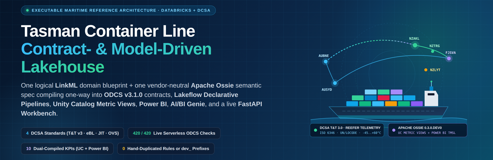
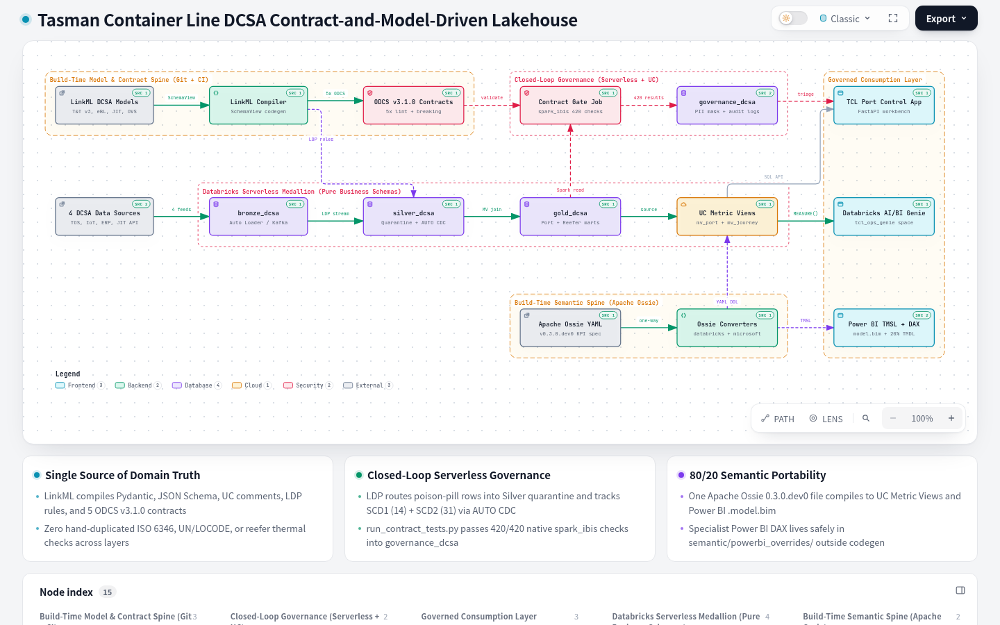
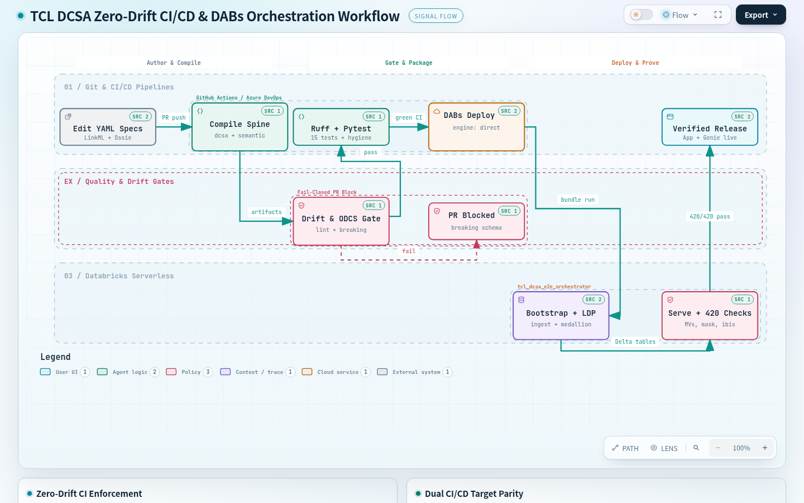
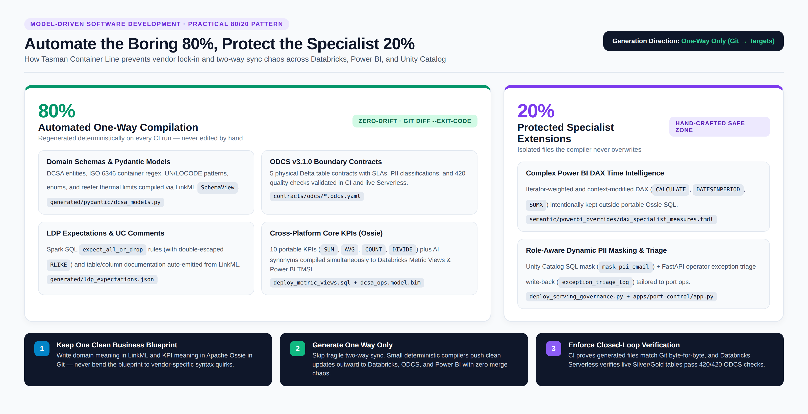

<p align="center">
  
</p>

<h1 align="center">Tasman Container Line (TCL) — DCSA Contract- &amp; Model-Driven Lakehouse</h1>

<p align="center">
  <a href="https://github.com/Jericho2010/tcl-dcsa-lakehouse/actions/workflows/ci-cd.yml"></a>
  <a href="pyproject.toml"></a>
  <a href="https://docs.astral.sh/uv/"></a>
  <a href="models/linkml/dcsa/dcsa_enterprise.yaml"></a>
  <a href="contracts/odcs/"></a>
  <a href="semantic/ossie/dcsa_ops.ossie.yaml"></a>
  <a href="databricks.yml"></a>
  <a href="LICENSE"></a>
</p>

> **An executable, end-to-end maritime reference Lakehouse proving how one logical LinkML domain model and one vendor-neutral Apache Ossie semantic spec eliminate schema and metric drift across Databricks Lakeflow Declarative Pipelines, ODCS v3.1.0 data contracts, Unity Catalog Metric Views, Power BI, AI/BI Genie, and a native FastAPI Workbench — verified live on Databricks Free Edition.**

<p align="center">
  
</p>

*(High-resolution interactive source: [`docs/infographics/tcl_lakehouse_one_pager.html`](docs/infographics/tcl_lakehouse_one_pager.html))*

---

## Table of Contents

1. [Why This Architecture Exists](#why-this-architecture-exists)
2. [Interactive Archify Architecture Diagrams](#interactive-archify-architecture-diagrams)
3. [Strict Layer Ownership Matrix](#strict-layer-ownership-matrix)
4. [The 80/20 Model-Driven Blueprint](#the-8020-model-driven-blueprint)
5. [Low-Toil Governed Lakehouse Principles](#low-toil-governed-lakehouse-principles)
6. [Deployment Modes: Free Edition vs. Azure Enterprise](#deployment-modes-free-edition-vs-azure-enterprise)
7. [Live Databricks Free Edition Verification](#live-databricks-free-edition-verification)
8. [2-Minute Local Quickstart](#2-minute-local-quickstart)
9. [Empirical Databricks Serverless &amp; Ossie Field Notes](#empirical-databricks-serverless--ossie-field-notes)
10. [Documentation &amp; Repository Map](#documentation--repository-map)
11. [Build Log](#build-log)

---

## Why This Architecture Exists

Enterprise data platforms rarely fail because teams cannot write Spark or SQL. They fail because **meaning gets rewritten five times**:

1. Domain architects sketch shipping standards in slide decks.
2. Data engineers hand-code regexes and bounds inside streaming pipelines.
3. Governance teams duplicate schemas in YAML contracts or catalog UIs.
4. BI developers re-implement core KPIs inside Power BI DAX.
5. AI/BI natural-language assistants guess SQL joins over undocumented tables.

**Tasman Container Line (TCL)** — a realistic regional ocean carrier operating across New Zealand (`NZAKL`, `NZTRG`, `NZLYT`), Australia (`AUBNE`, `AUSYD`), and the Pacific Islands (`FJSVA`) — models a disciplined alternative standardized on **DCSA (Digital Container Shipping Association)** standards (**Track &amp; Trace v3.0 with IoT/Reefer telemetry**, **Electronic Bill of Lading v3**, **Booking &amp; Operational Vessel Schedules**, and **Just-in-Time 5-Phase Port Call**).

Every tool owns **exactly one architectural layer**, and every downstream contract, pipeline check, semantic view, and BI model compiles **one-way from Git** with fail-closed CI drift gates (`git diff --exit-code`).

---

## Interactive Archify Architecture Diagrams

All diagrams in this repository are authored as **repository-backed Archify v3.0 diagrams** pinned to real source line ranges — zero Mermaid approximations, full clickable source links, light/dark themes, path tracing, and SVG/PNG export when opened locally.

### 1. End-to-End Platform &amp; Closed-Loop Governance Topology

<p align="center">
  
</p>

- **Interactive HTML:** Open [`docs/diagrams/tcl-platform-architecture.html`](docs/diagrams/tcl-platform-architecture.html) locally in any browser (spec: [`tcl-platform-architecture.candidate.json`](docs/diagrams/tcl-platform-architecture.candidate.json)).
- **What it proves:** Operational data flows left-to-right (`4 DCSA Sources` → `bronze_dcsa` → `silver_dcsa` → `gold_dcsa` → `UC Metric Views`), while build-time compilers push LinkML rules, ODCS v3.1.0 contracts, and Apache Ossie KPIs one-way into the Lakehouse and Power BI, closing the governance loop via `run_contract_tests.py` (`420/420` checks into `governance_dcsa`).

### 2. Medallion Lineage, Quarantine &amp; PII Dynamic Masking Flow

<p align="center">
  
</p>

- **Interactive HTML:** [`docs/diagrams/tcl-medallion-dataflow.html`](docs/diagrams/tcl-medallion-dataflow.html) (spec: [`tcl-medallion-dataflow.candidate.json`](docs/diagrams/tcl-medallion-dataflow.candidate.json)).
- **Deep dive:** See [`docs/ARCHITECTURE.md`](docs/ARCHITECTURE.md) and [`docs/DCSA_DOMAIN_MODEL.md`](docs/DCSA_DOMAIN_MODEL.md).

### 3. Zero-Drift CI/CD &amp; DABs Orchestration Workflow

<p align="center">
  
</p>

- **Interactive HTML:** [`docs/diagrams/tcl-cicd-orchestration.html`](docs/diagrams/tcl-cicd-orchestration.html) (spec: [`tcl-cicd-orchestration.candidate.json`](docs/diagrams/tcl-cicd-orchestration.candidate.json)).
- **Deep dive:** See [`docs/DEPLOYMENT_GUIDE.md`](docs/DEPLOYMENT_GUIDE.md).

---

## Strict Layer Ownership Matrix

| Layer | Tool / Standard | Source of Truth in Git | Execution Runtime | Compiled / Runtime Output |
| :--- | :--- | :--- | :--- | :--- |
| **1. Logical Domain Model** | **LinkML** (`SchemaView`) | [`models/linkml/dcsa/*.yaml`](models/linkml/dcsa/dcsa_enterprise.yaml) | CI / Local Python (`uv`) | Pydantic v2 models, JSON Schema, UC comments/PII map, Spark LDP expectations, 5 ODCS v3.1.0 contracts |
| **2. Operational Boundary Contracts** | **`datacontract-cli`** (ODCS v3.1.0) | [`contracts/odcs/*.odcs.yaml`](contracts/odcs/) | CI (`lint`, `breaking`) + Databricks Serverless (`spark_ibis`) | Fail-closed PR schema gates + `420/420` live audit rows in `<catalog>.governance_dcsa.contract_test_results` |
| **3. Streaming &amp; Batch Medallion** | **Lakeflow Declarative Pipelines (LDP)** | [`src/pipelines/dcsa_medallion/`](src/pipelines/dcsa_medallion/) | Databricks Serverless LDP (`pyspark.pipelines`) | Bronze Streaming Tables, LinkML-checked Silver + Quarantine tables, `AUTO CDC` SCD1 &amp; SCD2, Gold Materialized Views |
| **4. Vendor-Neutral Semantic Layer** | **Apache Ossie** (`0.3.0.dev0`) | [`semantic/ossie/dcsa_ops.ossie.yaml`](semantic/ossie/dcsa_ops.ossie.yaml) | Offline CI (`apache-ossie-databricks` + `apache-ossie-microsoft`) | Unity Catalog Metric Views DDL (`MEASURE()`) + Power BI TMSL `.model.bim` (10 KPIs, 0 `BLANK()`) |
| **5. Governed Serving &amp; Apps** | **UC Metric Views + Genie + FastAPI App** | [`apps/port-control/`](apps/port-control/), [`src/genie/`](src/genie/) | Databricks Serverless SQL Warehouse &amp; Apps Runtime | `mv_port_call_kpis`, `mv_container_journey_kpis`, `tcl_ops_genie`, and live `tcl-port-control` Workbench with triage write-back |
| **6. Packaging &amp; Promotion** | **DABs (`engine: direct`) + CI/CD** | [`databricks.yml`](databricks.yml), [`resources/*.yml`](resources/) | GitHub Actions (live) + Azure DevOps (enterprise ref) | Repeatable `dev` / `staging` / `prod` promotion with zero `dev_` schema prefixes |

---

## The 80/20 Model-Driven Blueprint

<p align="center">
  
</p>

*(Interactive source: [`docs/infographics/tcl_80_20_blueprint.html`](docs/infographics/tcl_80_20_blueprint.html) · Override guide: [`semantic/powerbi_overrides/README.md`](semantic/powerbi_overrides/README.md))*

Rather than attempting fragile two-way sync between Git, Databricks, and Power BI, this repository proves Martin Fowler's practical Model-Driven Engineering split:

- **Automate the boring 80% one-way:** Tables, joins, regexes, thermal bounds, PII metadata, ODCS contracts, UC Metric Views, and portable `SUM`/`AVG`/`COUNT`/`DIVIDE` KPIs regenerate deterministically from YAML on every CI run.
- **Protect the specialist 20% cleanly:** Advanced Power BI evaluation-context DAX (`CALCULATE`, `DATESINPERIOD`, `SUMX`) lives in [`semantic/powerbi_overrides/dax_specialist_measures.tmdl`](semantic/powerbi_overrides/dax_specialist_measures.tmdl) — never overwritten by codegen — while domain-specific PII masking and operator exception triage live in dedicated governance modules.

---

## Low-Toil Governed Lakehouse Principles

- **Workspace–Catalog SDLC Binding:** Environments isolate cleanly at the Unity Catalog boundary (`workspace` on Free Edition; `tcl_staging` / `tcl_prod` in Azure Enterprise). Schemas stay pure business subjects (`bronze_dcsa`, `silver_dcsa`, `gold_dcsa`, `governance_dcsa`) — **never** `dev_` schema prefixes.
- **Reuse Bronze by Default &amp; Quarantine Explicitly:** All raw events land untouched inside governed Unity Catalog Volumes (`/Volumes/<catalog>/bronze_dcsa/landing_*`). Poison pills (invalid ISO 6346 container numbers, invalid UN/LOCODEs, `-99.0°C` reefer sensor faults) are preserved in Bronze and cleanly diverted into `silver_dcsa.quarantine_*` with exact violated rule names.
- **Zero Hand-Duplicated Validation Rules:** [`src/tcl_compiler/compile_dcsa.py`](src/tcl_compiler/compile_dcsa.py) compiles LinkML `required`, `pattern`, `minimum_value`, `maximum_value`, and `enum` constraints directly into Pydantic models, ODCS contracts, and Spark SQL `@dp.expect_all_or_drop` rules.
- **80/20 Dynamic PII Masking:** Sensitive eBL columns (`shipper_contact_email`, `consignee_name`) tagged in [`models/linkml/dcsa/dcsa_ebl_v3.yaml`](models/linkml/dcsa/dcsa_ebl_v3.yaml) automatically propagate to ODCS and attach `<catalog>.governance_dcsa.mask_pii_email` on curated Silver eBL tables only — never corrupting upstream Bronze streams.
- **Consolidated Serverless Footprint:** Uses a single Serverless LDP pipeline (`dcsa_medallion_pipeline`) and a single Databricks App (`tcl-port-control`), honoring Databricks Free Edition quotas while mirroring enterprise modular layout.

---

## Deployment Modes: Free Edition vs. Azure Enterprise

Switching environments requires changing only DABs target variables (`catalog` and `ingestion_mode`) in [`databricks.yml`](databricks.yml) — zero code forks:

| Operational Source | DCSA Standard | `free_edition` (`dev` Target, `catalog=workspace`) | `azure_enterprise` (`staging` / `prod` Targets) |
| :--- | :--- | :--- | :--- |
| **1. PortGate TOS** | Track &amp; Trace (`EquipmentEvent`, `TransportEvent`) | Synthetic JSONL → UC Volume + Auto Loader `cloudFiles` | ADLS Gen2 / UC External Volume + Auto Loader `cloudFiles` |
| **2. ReeferPulse IoT Mesh** | Track &amp; Trace v3.0.0 (IoT/Reefer Telemetry) | Kafka-envelope JSONL in UC Volume + Auto Loader `cloudFiles` | LDP `spark.readStream.format("kafka")` → Azure Event Hubs SASL_SSL |
| **3. VoyageCore ERP** | eBL v3, Booking &amp; OVS (`TransportDocument`, `CarrierSchedule`) | CDC JSONL (`INSERT`/`UPDATE`/`DELETE` + out-of-order `sequence_ts`) → `AUTO CDC` | Lakeflow Connect Managed Bronze CDC → `AUTO CDC` SCD1 &amp; SCD2 |
| **4. HarbourSync Port API** | JIT Port Call (5-Phase Timestamps) | Serverless Lakeflow Job → UC Volume + Auto Loader `cloudFiles` | Serverless Lakeflow Job polling Port Authority REST API → UC Volume |
| **CI/CD Orchestrator** | Zero-Drift Compilation &amp; DABs Deploy | Live [`.github/workflows/ci-cd.yml`](.github/workflows/ci-cd.yml) | Enterprise [`azure-pipelines.yml`](azure-pipelines.yml) (`Compile_And_Gate` → `Dev` → `Staging` → `Prod`) |

---

## Live Databricks Free Edition Verification

Verified end-to-end against Databricks Free Edition (`dev` target, `catalog=workspace`, Serverless SQL Warehouse supplied at CLI runtime via `--var`):

- **5-Task Serverless Orchestrator (`tcl_dcsa_e2e_orchestrator`, run `1002918074181118`):** Every task finished **`TERMINATED / SUCCESS`** in sequence:
  1. `bootstrap_uc_objects` (`run_id=668779479510169`) — provisioned pure schemas (`bronze_dcsa`, `silver_dcsa`, `gold_dcsa`, `governance_dcsa`), 4 landing UC Volumes, and governance audit tables.
  2. `ingest_harboursync_jit` (`run_id=281430197022506`) — landed deterministic NZ/AU/Pacific datasets across all 4 DCSA operational feeds.
  3. `run_dcsa_medallion_pipeline` (`run_id=408750898674992`) — executed consolidated Serverless LDP (`dcsa_medallion_pipeline`).
  4. `deploy_serving_governance` (`run_id=749963866402415`) — deployed UC Metric Views DDL, UC comments, and Silver `mask_pii_email` dynamic mask.
  5. `run_contract_tests` (`run_id=651874174526977`) — executed all 5 ODCS contracts natively via `spark_ibis` and persisted results to `governance_dcsa.contract_test_results`.
- **Live UC Metric Views (`MEASURE(...)`):**
  - `workspace.gold_dcsa.mv_port_call_kpis`: **15 vessel port calls** (**12 on-time**) across `AUBNE`, `AUSYD`, `FJSVA`, `NZAKL`, `NZLYT`, `NZTRG`.
  - `workspace.gold_dcsa.mv_container_journey_kpis`: **30 container moves**, **`active_ebl_count = 1`** per port, flagging reefer thermal excursions on `NZLYT` (`2/8 = 25%`) and `NZTRG` (`2/4 = 50%`).
- **Quarantine, `AUTO CDC` &amp; PII Proof:**
  - `quarantine_portgate_equipment_events = 2` (`BAD-CONT-99`, `12345`) · `quarantine_reeferpulse_iot_telemetry = 1` (`-99.0°C` fault).
  - `silver_dcsa_ebl_current` (SCD1) = **14** · `silver_dcsa_ebl_history` (SCD2) = **31** (out-of-order `sequence_ts` &amp; `DELETE` reconciled).
  - `shipper_contact_email` on `silver_dcsa_ebl_current` returns masked addresses (`ex***@tasman-shipper.example`).
- **Native Serverless `datacontract-cli` (`spark_ibis`):** **420 / 420 checks passed (`0` failures)** across all 5 contracts:
  - `tcl-gold-dcsa-port-call-kpis`: `57/57` · `tcl-harboursync-jit-port-calls`: `55/55` · `tcl-portgate-tos-events`: `112/112` · `tcl-reeferpulse-iot-telemetry`: `71/71` · `tcl-voyagecore-ebl-bookings`: `125/125`.
- **Live Serving Surfaces:** `tcl-port-control` FastAPI App verified **`RUNNING` / `ACTIVE` / `SUCCEEDED`**, alongside live `TCL DCSA Port & Reefer Operations Genie` Space (`space_id: 01f1e8a9d75210eebed8df45562470e2`).

---

## 2-Minute Local Quickstart

No cloud account is required to compile the full model/contract/semantic spine, lint all 5 ODCS contracts, test breaking-change detection, and explore the Port Control Workbench locally in demo mode:

```bash
# 1. Install Python 3.12 dependencies cleanly via uv
./setup.sh

# 2. Recompile LinkML & Apache Ossie, lint all 5 ODCS contracts, run ruff + pytest
./run.sh

# 3. Generate deterministic sample DCSA landing feeds locally (gitignored)
uv run python -m generators.dcsa_synthetic_generator --output-dir data/sample_landing

# 4. Launch the TCL Port Control FastAPI Workbench locally (demo mode)
./run.sh --serve-app
# Open http://127.0.0.1:8000
```

For full **Databricks Free Edition live deployment**, **GitHub Actions CD**, and **Azure DevOps Enterprise promotion** steps, see [`docs/DEPLOYMENT_GUIDE.md`](docs/DEPLOYMENT_GUIDE.md).

---

## Empirical Databricks Serverless &amp; Ossie Field Notes

Real-world runtime constraints discovered and codified via self-annealing during live Free Edition execution:

1. **Databricks Serverless `spark_python_task` runs in an IPython `exec(...)` wrapper:** Calling `raise SystemExit(0)` marks a successful task as **FAILED**, and `__file__` is undefined. All job entrypoints return `0` normally (raising only on non-zero errors) and resolve bundle roots via `_resolve_project_root()` with `Path.cwd()` fallback.
2. **Spark SQL `RLIKE` string literal escaping:** Single backslashes (`\s`, `\.`) inside Spark SQL string literals unescape before regex compilation (turning `[^@\s]` into `[^@s]` — rejecting any email containing the letter `s`). [`compile_dcsa.py`](src/tcl_compiler/compile_dcsa.py) automatically double-escapes backslashes (`\\s`, `\\.`) in `generated/ldp_expectations.json`.
3. **Native `datacontract-cli` (`spark_ibis`) on Databricks Serverless:** Requires unqualified ODCS `physicalName` (since `servers[0].schema` sets the UC schema), `pandas>=2.1,<3.0` (avoiding `pandas 3.x` `OptionError` in `ibis`), and omitting `ibis-framework[pyspark]` from Serverless job dependencies so PyPI `pyspark` never shadows Databricks managed `databricks-connect`.
4. **Apply Dynamic PII Masks on Curated Silver — Never Raw Bronze:** Masking raw Bronze streaming tables alters payloads read by downstream Silver expectations. `mask_pii_email` is attached exclusively to `silver_dcsa.silver_dcsa_ebl_current` and `silver_dcsa.silver_dcsa_ebl_history`.
5. **Apache Ossie Dual-Target Metric Placement &amp; Power BI `--pbip`:** `ossie-databricks deploy` compiles dataset-scoped metrics into UC Metric View measures, whereas `ossie-microsoft export` (`0.2.0.dev0`) compiles model-scoped metrics into Power BI DAX. Mirroring qualified model-scoped metrics emits all 10 measures cleanly on both platforms (`0` `BLANK()` fallbacks). Pure-Python `ossie-microsoft export` emits `dcsa_ops.model.bim` on Linux; `--pbip` split-TMDL export requires optional .NET TOM assemblies (`apache-ossie-microsoft[tom]`).

---

## Documentation &amp; Repository Map

| Document / Path | Purpose |
| :--- | :--- |
| [`docs/ARCHITECTURE.md`](docs/ARCHITECTURE.md) | Deep architectural walkthrough of every layer, data flow, closed-loop governance, and trade-offs |
| [`docs/DCSA_DOMAIN_MODEL.md`](docs/DCSA_DOMAIN_MODEL.md) | Reference for DCSA T&amp;T v3.0, eBL v3, JIT Port Call, OVS schemas, compiled rules, and KPI glossary |
| [`docs/DEPLOYMENT_GUIDE.md`](docs/DEPLOYMENT_GUIDE.md) | Step-by-step Local, Databricks Free Edition, GitHub Actions, and Azure DevOps Enterprise guide |
| [`docs/diagrams/`](docs/diagrams/) | 3 interactive repository-backed **Archify v3.0** HTML diagrams, JSON specs, and PNG previews |
| [`docs/infographics/`](docs/infographics/) | Executive one-pager, 80/20 blueprint, and maritime hero banner (HTML sources + 2× HiDPI PNGs) |
| [`SECURITY.md`](SECURITY.md) | Security boundary, zero-secret hygiene controls, dynamic PII masking, and quarantine guarantees |
| [`CONTRIBUTING.md`](CONTRIBUTING.md) | Zero-drift workflow for evolving LinkML models, ODCS contracts, and Apache Ossie KPIs |
| [`models/linkml/dcsa/`](models/linkml/dcsa/) | Modular LinkML DCSA source schemas (`dcsa_common`, `dcsa_tnt_v3`, `dcsa_ebl_v3`, `dcsa_jit_v1`, `dcsa_enterprise`) |
| [`contracts/odcs/`](contracts/odcs/) | 5 compiled ODCS v3.1.0 contracts validated in CI and live Serverless |
| [`semantic/ossie/`](semantic/ossie/) &amp; [`semantic/powerbi_overrides/`](semantic/powerbi_overrides/) | Canonical Apache Ossie `0.3.0.dev0` spec + protected 20% Power BI DAX override sidecar |
| [`src/tcl_compiler/`](src/tcl_compiler/) | Deterministic LinkML (`compile_dcsa.py`) and Apache Ossie (`compile_semantic.py`) compilers |
| [`src/pipelines/dcsa_medallion/`](src/pipelines/dcsa_medallion/) | Consolidated Serverless `pyspark.pipelines` Medallion pipeline (Bronze, Silver, Quarantine, AUTO CDC, Gold) |
| [`src/jobs/`](src/jobs/) &amp; [`apps/port-control/`](apps/port-control/) | Serverless UC bootstrap, ingestion, serving/masking, contract verification jobs, and FastAPI Workbench |
| [`databricks.yml`](databricks.yml) &amp; [`resources/`](resources/) | `direct`-engine Databricks Declarative Automation Bundle (`dev`, `staging`, `prod`) |

---

## Build Log

- **2026-11-25 - Phase 1 Model, Contract &amp; Semantic Spine** — Bootstrapped `uv` Python 3.12 environment, authored 5 LinkML DCSA domain models, compiled 5 valid ODCS v3.1.0 contracts + Pydantic/JSON Schema/UC/LDP artifacts, verified `datacontract changelog`/`breaking`, authored `semantic/ossie/dcsa_ops.ossie.yaml` (`0.3.0.dev0`), compiled Databricks Metric Views SQL DDL and Power BI `dcsa_ops.model.bim` (10 DAX measures), and verified `pytest` + `ruff`.
- **2026-11-25 - Phase 2 Sources, LDP Pipeline, Jobs, App, DABs &amp; CI/CD** — Built deterministic NZ/AU/Pacific DCSA generator across all 4 sources (with deliberate quarantine and out-of-order CDC cases); implemented consolidated `pyspark.pipelines` medallion pipeline (`free_edition` and `azure_enterprise` ingestion, dynamic `expect_all_or_drop` + quarantine tables, `AUTO CDC` SCD1/SCD2, Gold KPI marts); added serverless UC bootstrap, ingestion, serving/PII-masking governance, and live `DataContract.test()` jobs; built `apps/port-control` FastAPI workbench, Genie Space config, `direct`-engine DABs bundle, GitHub Actions &amp; Azure Pipelines CI/CD workflows, `SECURITY.md`, MIT `LICENSE`, and full test suite.
- **2026-11-26 - Phase 3 &amp; 4 Live Databricks Free Edition Verification &amp; CI/CD Hardening** — Verified end-to-end 5-task orchestrator run `1002918074181118` (all tasks `SUCCESS`, `420/420` native `spark_ibis` ODCS checks, 6 live SQL proofs, live `tcl-port-control` App and Genie Space), aligned ODCS contracts to curated `silver_dcsa`/`gold_dcsa` tables with Silver-only PII masking, expanded repository hygiene gates, and published private GitHub repository with green GitHub Actions CI.
- **2026-11-27 - Documentation Overhaul, Archify Diagrams &amp; Executive Infographics** — Replaced Mermaid with 3 repository-backed, browser-verified **Archify v3.0** showcase diagrams (`architecture`, `dataflow`, `workflow` v2) with PNG previews and interactive HTML sources; generated 3 2× HiDPI editorial infographics (maritime hero banner, executive one-pager, 80/20 MDSD blueprint); authored comprehensive `docs/ARCHITECTURE.md`, `docs/DCSA_DOMAIN_MODEL.md`, `docs/DEPLOYMENT_GUIDE.md`, and `CONTRIBUTING.md`; expanded automated hygiene and zero-Mermaid tests.
