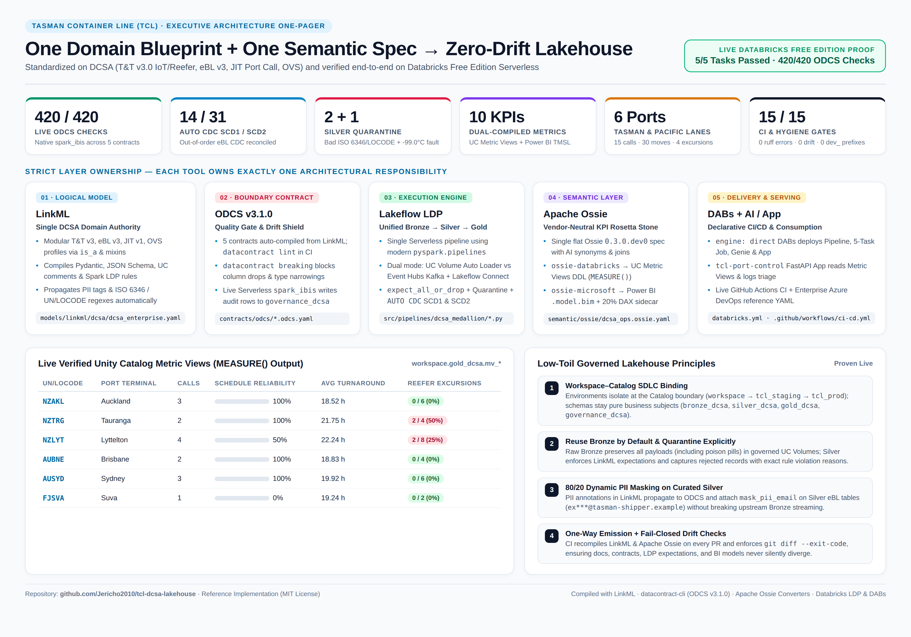
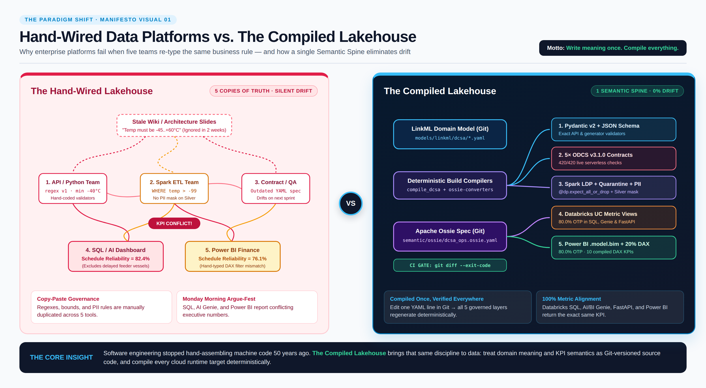
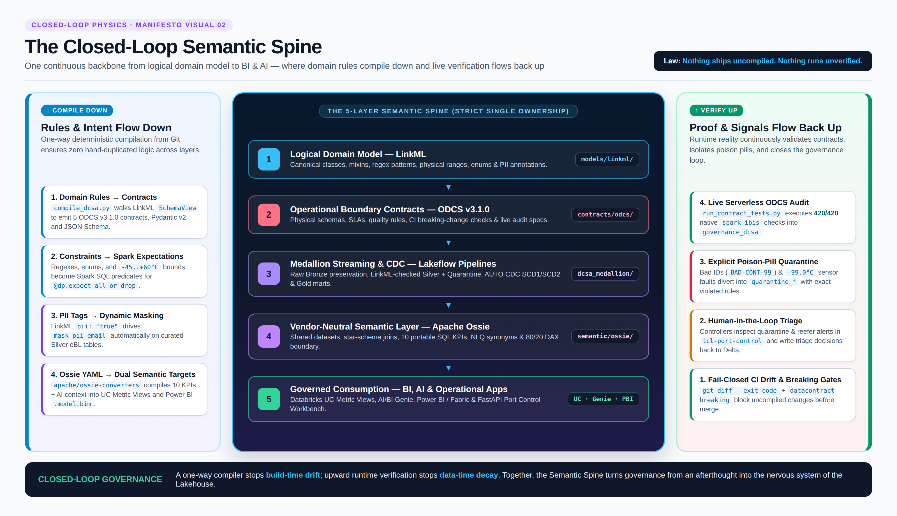
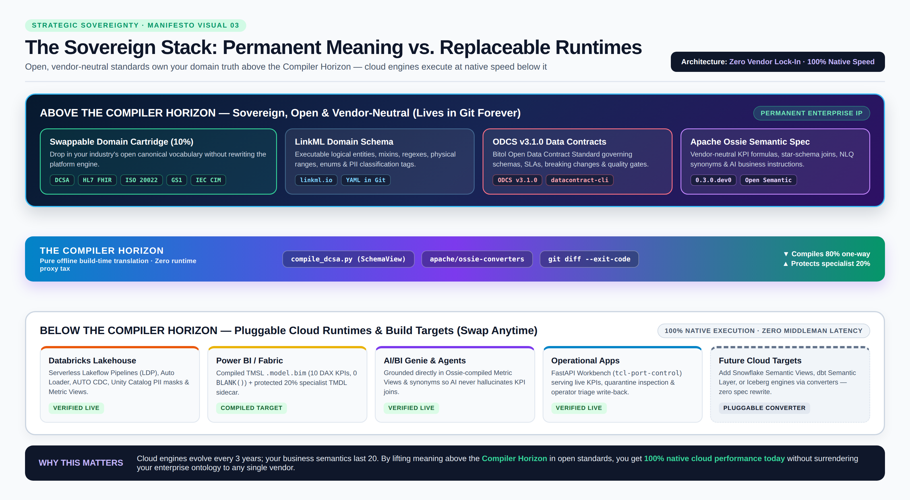
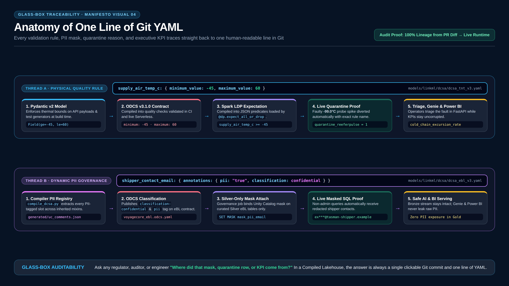
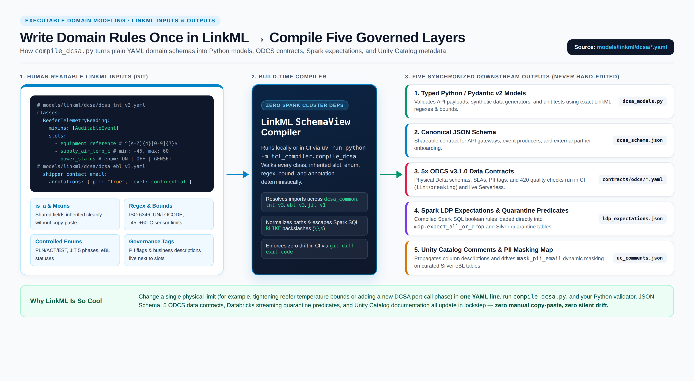
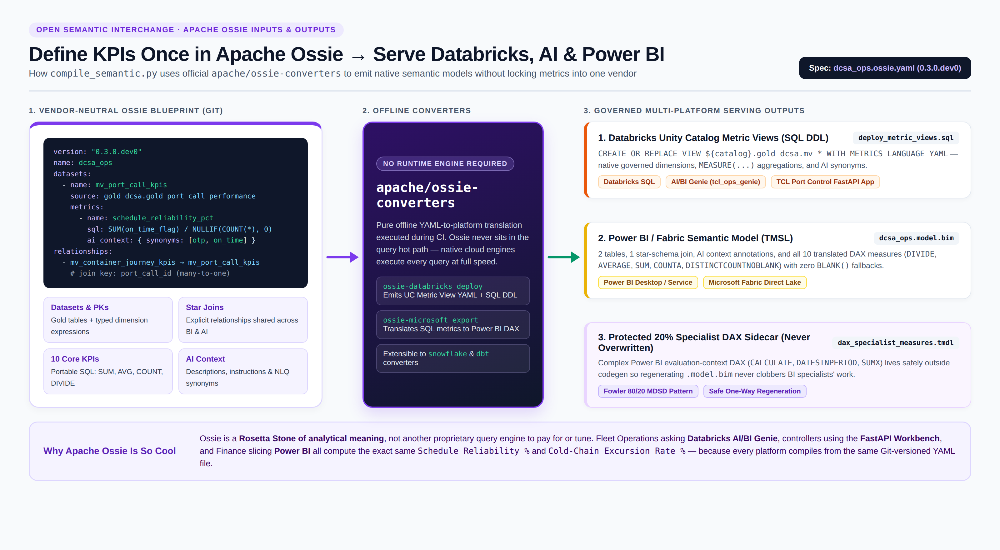
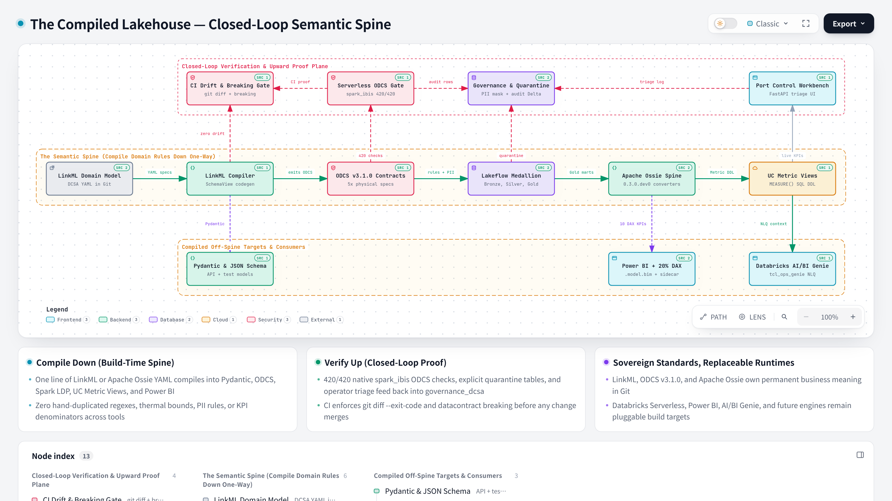
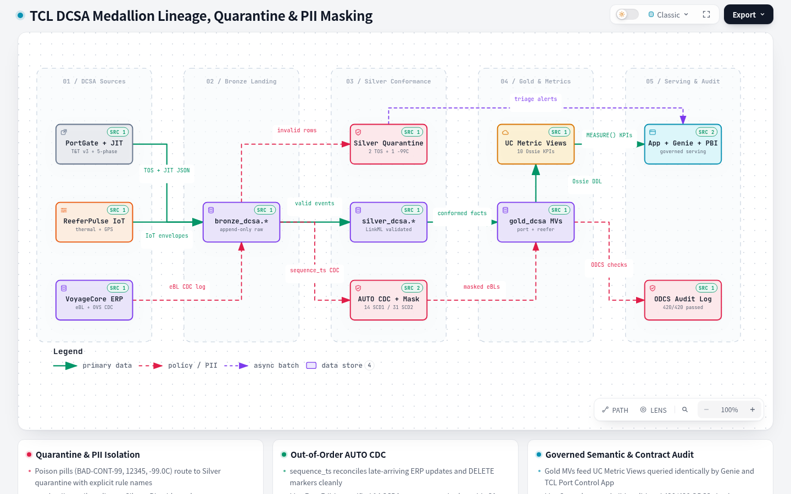

<p align="center">
  
</p>

<h1 align="center">The Compiled Lakehouse</h1>
<p align="center"><strong>Write meaning once. Compile the entire Lakehouse through a closed-loop Semantic Spine.</strong><br/><em>Tasman Container Line (TCL) — DCSA Reference Implementation on Databricks &amp; Power BI</em></p>

<p align="center">
  <a href="https://github.com/Jericho2010/tcl-dcsa-lakehouse/actions/workflows/ci-cd.yml"></a>
  <a href="pyproject.toml"></a>
  <a href="https://docs.astral.sh/uv/"></a>
  <a href="models/linkml/dcsa/dcsa_enterprise.yaml"></a>
  <a href="contracts/odcs/"></a>
  <a href="semantic/ossie/dcsa_ops.ossie.yaml"></a>
  <a href="databricks.yml"></a>
  <a href="LICENSE"></a>
</p>

> **One continuous Semantic Spine from Logical Domain Model → Operational Contracts → Pipelines → Semantic Layer → BI &amp; AI.** Open, vendor-neutral standards (**LinkML**, **ODCS v3.1.0**, **Apache Ossie**) own your permanent business meaning while cloud engines (**Databricks**, **Power BI**, **Fabric**, **Snowflake**) become replaceable runtimes. Rules compile down; live verification (`420/420` `spark_ibis` checks + quarantine) flows back up; and every rule, PII mask, quarantine reason, and KPI formula traces straight back to one line of Git YAML.
>
> **Read the full 7-act architectural manifesto:** [`docs/THE_COMPILED_LAKEHOUSE.md`](docs/THE_COMPILED_LAKEHOUSE.md) · **Share it:** [`docs/LINKEDIN_LAUNCH_KIT.md`](docs/LINKEDIN_LAUNCH_KIT.md)

> [!NOTE]
> **Fictional Scenario &amp; Synthetic Data Disclaimer:** **Tasman Container Line (TCL)**, all four operational source systems (**PortGate TOS**, **ReeferPulse IoT Mesh**, **VoyageCore ERP**, and **HarbourSync Port API**), all vessels (`MV TASMAN HORIZON`, `MV AOTEAROA STAR`, `MV CORAL TRADER`), container numbers, eBL documents, `@tasman-shipper.example` contacts, and KPI metrics are **100% fictional and synthetically generated** for this open-source architectural reference lab. No real ocean carrier, customer, employer, or proprietary production data is represented.

<p align="center">
  
</p>

*(High-resolution interactive source: [`docs/infographics/tcl_lakehouse_one_pager.html`](docs/infographics/tcl_lakehouse_one_pager.html))*

---

## Table of Contents

1. [The Compiled Lakehouse: Visual Manifesto](#the-compiled-lakehouse-visual-manifesto)
2. [The Fictional Backstory: Tasman Container Line (TCL)](#the-fictional-backstory-tasman-container-line-tcl)
3. [New to DCSA, LinkML, or Apache Ossie? (And Going Beyond Shipping)](#new-to-dcsa-linkml-or-apache-ossie-and-going-beyond-shipping)
4. [Interactive Archify Architecture Diagrams](#interactive-archify-architecture-diagrams)
5. [Strict Layer Ownership Matrix](#strict-layer-ownership-matrix)
6. [The 80/20 Model-Driven Blueprint](#the-8020-model-driven-blueprint)
7. [Low-Toil Governed Lakehouse Principles](#low-toil-governed-lakehouse-principles)
8. [Deployment Modes: Free Edition vs. Azure Enterprise](#deployment-modes-free-edition-vs-azure-enterprise)
9. [Live Databricks Free Edition Verification](#live-databricks-free-edition-verification)
10. [Build It Yourself (2-Min Local / 10-Min Databricks Free Edition)](#build-it-yourself-2-min-local--10-min-databricks-free-edition)
11. [Empirical Databricks Serverless &amp; Ossie Field Notes](#empirical-databricks-serverless--ossie-field-notes)
12. [Documentation &amp; Repository Map](#documentation--repository-map)
13. [Build Log](#build-log)

---

## The Compiled Lakehouse: Visual Manifesto

Why treat data platforms differently from compiled software? Read the complete 7-act thesis in [`docs/THE_COMPILED_LAKEHOUSE.md`](docs/THE_COMPILED_LAKEHOUSE.md) — or scan the four visual pillars below:

### Hand-Wired vs. Compiled
<p align="center">
  
</p>

### The Closed-Loop Semantic Spine (Compile Down · Verify Up)
<p align="center">
  
</p>

### The Sovereign Stack (Permanent Meaning vs. Replaceable Runtimes)
<p align="center">
  
</p>

### Glass-Box Traceability (Anatomy of One Line of Git YAML)
<p align="center">
  
</p>

---

## The Fictional Backstory: Tasman Container Line (TCL)

### Meet TCL (Fictional Regional Ocean Carrier)

Founded in 2014 in Auckland (`NZAKL`), **Tasman Container Line (TCL)** is a fictional regional container shipping line moving temperature-sensitive New Zealand primary exports — dairy, kiwifruit, king salmon, and chilled beef — alongside general container freight across a tight weekly six-port Tasman Sea and South Pacific liner loop:

> **Auckland (`NZAKL`) → Tauranga (`NZTRG`) → Lyttelton (`NZLYT`) → Brisbane (`AUBNE`) → Sydney (`AUSYD`) → Suva (`FJSVA`)**

TCL operates three geared container vessels — **`MV TASMAN HORIZON`**, **`MV AOTEAROA STAR`**, and **`MV CORAL TRADER`** — on razor-thin berth windows. A single four-hour reefer compressor fault at Tauranga or Lyttelton can spoil NZ$250,000 of chilled cargo, while one missed berth slot cascades delays across every downstream port in the loop.

### Why TCL Needed a Contract- &amp; Model-Driven Lakehouse

Enterprise data platforms rarely fail because engineers cannot write Spark or SQL — they fail because **business meaning gets rewritten five times across siloed tools**. Before standardizing on **DCSA (Digital Container Shipping Association)** open standards, TCL's lean data team faced four recurring operational failures across its four fictional source systems:

1. **PortGate TOS** *(fictional Terminal Operating System)* sent gate/load/discharge webhooks containing legacy terminal typos and malformed container IDs (`BAD-CONT-99`, `12345`) that silently broke downstream equipment joins.
2. **ReeferPulse IoT Mesh** *(fictional Smart Container Telemetry Platform)* streamed live reefer temperatures — including faulty `-99.0°C` probe spikes that skewed fleet thermal averages and hid genuine `-11.2°C` cold-chain excursions.
3. **VoyageCore ERP** *(fictional Booking &amp; Documentation System)* emitted out-of-order Electronic Bill of Lading (`eBL`) state transitions (`DRFT` → `APPR` → `ISSU` → `SURR` / `DELETE`) alongside unmasked shipper PII (`shipper_contact_email`, `consignee_name`).
4. **HarbourSync Port API** *(fictional Port Authority Integration)* delivered 5-phase Just-in-Time (`JIT`) berth timestamps, yet Fleet Operations (Databricks SQL) and Finance (Power BI) reported conflicting **"Schedule Reliability %"** numbers every Monday morning.

TCL solved all four problems with a **Low-Toil Governed Lakehouse**: every tool owns **exactly one architectural layer**, and every downstream contract, pipeline expectation, Unity Catalog Metric View, and Power BI model compiles **one-way from Git** with fail-closed CI drift gates (`git diff --exit-code`).

---

## New to DCSA, LinkML, or Apache Ossie? (And Going Beyond Shipping)

Even if you have never worked in container shipping, the three open standards powering this Lakehouse are **domain-agnostic blueprints** you can transplant straight into healthcare, banking, retail, telecom, or energy.

### What Is DCSA? (And How It Compares Across Industries)

**DCSA** (*Digital Container Shipping Association*, [dcsa.org](https://dcsa.org/)) is the non-profit standards body created by global ocean carriers so terminals, ports, vessels, and shippers share one open digital vocabulary — **Track &amp; Trace v3.0 (with Reefer IoT)**, **Electronic Bill of Lading (eBL v3)**, **Just-in-Time (JIT) Port Calls**, and **Operational Vessel Schedules (OVS)**. It fills the exact same interoperability role that open industry standards fill elsewhere:

| Industry | Equivalent Standard to DCSA | What It Standardizes |
| :--- | :--- | :--- |
| **Maritime Shipping** *(this lab)* | **DCSA** (T&amp;T v3, eBL, JIT, OVS) | Container events, reefer IoT, Bills of Lading, vessel berth phases |
| **Healthcare** | **HL7 FHIR** | Patients, encounters, lab observations, ICU vitals &amp; clinical orders |
| **Banking &amp; Payments** | **ISO 20022** / **BIAN** | Payment initiation (`pacs.008`), settlement lifecycles, `IBAN`/`BIC` |
| **Retail &amp; Cold-Chain** | **GS1 / EPCIS 2.0** | `GTIN`/`GLN` supply-chain scans, warehouse &amp; chiller telemetry |
| **Energy &amp; Utilities** | **IEC CIM** | Smart-meter readings, substation telemetry, grid outages &amp; dispatch |
| **Telecom &amp; Insurance** | **TM Forum Open APIs** / **ACORD** | Network alarms, service orders, claims lifecycles &amp; PII parties |

### Why LinkML Is Such a Cool Idea (Executable Domain Modeling)

Normally, logical data models rot inside slide decks while engineers copy-paste regexes, numeric bounds, and PII tags into five separate tools. **LinkML** ([linkml.io](https://linkml.io/)) turns plain, PR-reviewable YAML into an **executable compiler input** — change one rule in `models/linkml/dcsa/*.yaml`, run `compile_dcsa.py`, and **five governed layers** update in lockstep:

<p align="center">
  
</p>

*(Interactive source: [`docs/infographics/tcl_linkml_io.html`](docs/infographics/tcl_linkml_io.html))*

### Why Apache Ossie Is Such a Cool Idea (Vendor-Neutral Semantic Rosetta Stone)

Even with clean Gold Delta tables, metrics quietly drift between Databricks SQL, AI assistants, and Power BI. **Apache Ossie** (*Open Semantic Interchange*, [ossie.apache.org](https://ossie.apache.org/)) is **not** another query engine sitting in your hot path — it is an **offline semantic blueprint** compiled one-way by official `apache/ossie-converters` into native Databricks Unity Catalog Metric Views and Power BI `.model.bim`, while leaving specialist DAX safely untouched:

<p align="center">
  
</p>

*(Interactive source: [`docs/infographics/tcl_ossie_io.html`](docs/infographics/tcl_ossie_io.html))*

### Shifting This Entire Pipeline to Another Industry (~90% Unchanged)

Because compilers, ODCS contract gates, Lakeflow Declarative Pipelines, quarantine tables, `AUTO CDC`, dynamic PII masking, DABs, and CI/CD are **metadata-driven**, shifting this entire Lakehouse out of shipping requires swapping **only ~10% of the repo** (the LinkML schemas + Ossie YAML):

| Target Industry | Swap LinkML Domain (`models/linkml/`) | Swap Telemetry Quarantine | Swap CDC + PII Masking | Swap Apache Ossie KPIs (`semantic/ossie/`) |
| :--- | :--- | :--- | :--- | :--- |
| **Healthcare (HL7 FHIR)** | `Patient`, `Encounter`, `Observation` | Spo2 `0–100%`, Heart Rate `20–240 bpm` | Patient/Order SCD2 + `patient_email` / `nhi_number` | Bed Turnaround Mins, ICU Alert Rate, Sepsis SLA % |
| **Banking (ISO 20022)** | `PaymentInstruction`, `SettlementEvent` | `IBAN`/`BIC` regex, `amount > 0` | Payment `PDNG→ACSC` SCD2 + `debtor_iban` | Straight-Through Processing %, High-Value Latency |
| **Cold-Chain Retail (GS1)** | `EPCISEvent`, `ChillerReading` | `GTIN-14` regex, `-30..+8°C` chiller bounds | Recall / Lot SCD2 + `supplier_email` | Shelf-Stock Reliability %, Chiller Excursion % |
| **Energy Grid (IEC CIM)** | `SubstationEvent`, `SmartMeterReading` | `voltage_v` `180–260V`, kWh bounds | Outage Ticket SCD2 + `account_holder_email` | SAIDI / SAIFI Outage Mins, Peak Load Factor % |

> **Full Deep-Dive Guide:** Read [`docs/CONCEPTS_AND_INDUSTRY_PORTABILITY.md`](docs/CONCEPTS_AND_INDUSTRY_PORTABILITY.md) for a complete walkthrough of DCSA, LinkML, Apache Ossie, and a 5-step fork guide for transplanting this Lakehouse into your own domain.

---

## Interactive Archify Architecture Diagrams

All diagrams in this repository are authored as **repository-backed Archify v3.0 diagrams** pinned to real source line ranges — zero Mermaid approximations, full clickable source links, light/dark themes, path tracing, and SVG/PNG export when opened locally.

### 1. The Closed-Loop Semantic Spine (Compile Down · Verify Up)

<p align="center">
  
</p>

- **Interactive HTML:** Open [`docs/diagrams/tcl-semantic-spine-loop.html`](docs/diagrams/tcl-semantic-spine-loop.html) locally (spec: [`tcl-semantic-spine-loop.candidate.json`](docs/diagrams/tcl-semantic-spine-loop.candidate.json)).
- **What it proves:** One continuous Semantic Spine compiles rules down from LinkML → ODCS v3.1.0 → Lakeflow Medallion → Apache Ossie → UC Metric Views / Power BI / Genie, while live `420/420` `spark_ibis` checks, quarantine rows, operator triage, and `git diff --exit-code` close the governance loop upward.

### 2. End-to-End Platform &amp; Closed-Loop Governance Topology

<p align="center">
  
</p>

- **Interactive HTML:** Open [`docs/diagrams/tcl-platform-architecture.html`](docs/diagrams/tcl-platform-architecture.html) locally in any browser (spec: [`tcl-platform-architecture.candidate.json`](docs/diagrams/tcl-platform-architecture.candidate.json)).
- **What it proves:** Operational data flows left-to-right (`4 DCSA Sources` → `bronze_dcsa` → `silver_dcsa` → `gold_dcsa` → `UC Metric Views`), while build-time compilers push LinkML rules, ODCS v3.1.0 contracts, and Apache Ossie KPIs one-way into the Lakehouse and Power BI, closing the governance loop via `run_contract_tests.py` (`420/420` checks into `governance_dcsa`).

### 3. Medallion Lineage, Quarantine &amp; PII Dynamic Masking Flow

<p align="center">
  
</p>

- **Interactive HTML:** [`docs/diagrams/tcl-medallion-dataflow.html`](docs/diagrams/tcl-medallion-dataflow.html) (spec: [`tcl-medallion-dataflow.candidate.json`](docs/diagrams/tcl-medallion-dataflow.candidate.json)).
- **Deep dive:** See [`docs/ARCHITECTURE.md`](docs/ARCHITECTURE.md) and [`docs/DCSA_DOMAIN_MODEL.md`](docs/DCSA_DOMAIN_MODEL.md).

### 4. Zero-Drift CI/CD &amp; DABs Orchestration Workflow

<p align="center">
  
</p>

- **Interactive HTML:** [`docs/diagrams/tcl-cicd-orchestration.html`](docs/diagrams/tcl-cicd-orchestration.html) (spec: [`tcl-cicd-orchestration.candidate.json`](docs/diagrams/tcl-cicd-orchestration.candidate.json)).
- **Deep dive:** See [`docs/DEPLOYMENT_GUIDE.md`](docs/DEPLOYMENT_GUIDE.md).

---

## Strict Layer Ownership Matrix

| Layer | Tool / Standard | Source of Truth in Git | Execution Runtime | Compiled / Runtime Output |
| :--- | :--- | :--- | :--- | :--- |
| **1. Logical Domain Model** | **LinkML** (`SchemaView`) | [`models/linkml/dcsa/*.yaml`](models/linkml/dcsa/dcsa_enterprise.yaml) | CI / Local Python (`uv`) | Pydantic v2 models, JSON Schema, UC comments/PII map, Spark LDP expectations, 5 ODCS v3.1.0 contracts |
| **2. Operational Boundary Contracts** | **`datacontract-cli`** (ODCS v3.1.0) | [`contracts/odcs/*.odcs.yaml`](contracts/odcs/) | CI (`lint`, `breaking`) + Databricks Serverless (`spark_ibis`) | Fail-closed PR schema gates + `420/420` live audit rows in `<catalog>.governance_dcsa.contract_test_results` |
| **3. Streaming &amp; Batch Medallion** | **Lakeflow Declarative Pipelines (LDP)** | [`src/pipelines/dcsa_medallion/`](src/pipelines/dcsa_medallion/) | Databricks Serverless LDP (`pyspark.pipelines`) | Bronze Streaming Tables, LinkML-checked Silver + Quarantine tables, `AUTO CDC` SCD1 &amp; SCD2, Gold Materialized Views |
| **4. Vendor-Neutral Semantic Layer** | **Apache Ossie** (`0.3.0.dev0`) | [`semantic/ossie/dcsa_ops.ossie.yaml`](semantic/ossie/dcsa_ops.ossie.yaml) | Offline CI (`apache-ossie-databricks` + `apache-ossie-microsoft`) | Unity Catalog Metric Views DDL (`MEASURE()`) + Power BI TMSL `.model.bim` (10 KPIs, 0 `BLANK()`) |
| **5. Governed Serving &amp; Apps** | **UC Metric Views + Genie + FastAPI App** | [`apps/port-control/`](apps/port-control/), [`src/genie/`](src/genie/) | Databricks Serverless SQL Warehouse &amp; Apps Runtime | `mv_port_call_kpis`, `mv_container_journey_kpis`, `tcl_ops_genie`, and live `tcl-port-control` Workbench with triage write-back |
| **6. Packaging &amp; Promotion** | **DABs (`engine: direct`) + CI/CD** | [`databricks.yml`](databricks.yml), [`resources/*.yml`](resources/) | GitHub Actions (live) + Azure DevOps (enterprise ref) | Repeatable `dev` / `staging` / `prod` promotion with zero `dev_` schema prefixes |

---

## The 80/20 Model-Driven Blueprint

<p align="center">
  
</p>

*(Interactive source: [`docs/infographics/tcl_80_20_blueprint.html`](docs/infographics/tcl_80_20_blueprint.html) · Override guide: [`semantic/powerbi_overrides/README.md`](semantic/powerbi_overrides/README.md))*

Rather than attempting fragile two-way sync between Git, Databricks, and Power BI, this repository proves Martin Fowler's practical Model-Driven Engineering split:

- **Automate the boring 80% one-way:** Tables, joins, regexes, thermal bounds, PII metadata, ODCS contracts, UC Metric Views, and portable `SUM`/`AVG`/`COUNT`/`DIVIDE` KPIs regenerate deterministically from YAML on every CI run.
- **Protect the specialist 20% cleanly:** Advanced Power BI evaluation-context DAX (`CALCULATE`, `DATESINPERIOD`, `SUMX`) lives in [`semantic/powerbi_overrides/dax_specialist_measures.tmdl`](semantic/powerbi_overrides/dax_specialist_measures.tmdl) — never overwritten by codegen — while domain-specific PII masking and operator exception triage live in dedicated governance modules.

---

## Low-Toil Governed Lakehouse Principles

- **Workspace–Catalog SDLC Binding:** Environments isolate cleanly at the Unity Catalog boundary (`workspace` on Free Edition; `tcl_staging` / `tcl_prod` in Azure Enterprise). Schemas stay pure business subjects (`bronze_dcsa`, `silver_dcsa`, `gold_dcsa`, `governance_dcsa`) — **never** `dev_` schema prefixes.
- **Reuse Bronze by Default &amp; Quarantine Explicitly:** All raw events land untouched inside governed Unity Catalog Volumes (`/Volumes/<catalog>/bronze_dcsa/landing_*`). Poison pills (invalid ISO 6346 container numbers, invalid UN/LOCODEs, `-99.0°C` reefer sensor faults) are preserved in Bronze and cleanly diverted into `silver_dcsa.quarantine_*` with exact violated rule names.
- **Zero Hand-Duplicated Validation Rules:** [`src/tcl_compiler/compile_dcsa.py`](src/tcl_compiler/compile_dcsa.py) compiles LinkML `required`, `pattern`, `minimum_value`, `maximum_value`, and `enum` constraints directly into Pydantic models, ODCS contracts, and Spark SQL `@dp.expect_all_or_drop` rules.
- **80/20 Dynamic PII Masking:** Sensitive eBL columns (`shipper_contact_email`, `consignee_name`) tagged in [`models/linkml/dcsa/dcsa_ebl_v3.yaml`](models/linkml/dcsa/dcsa_ebl_v3.yaml) automatically propagate to ODCS and attach `<catalog>.governance_dcsa.mask_pii_email` on curated Silver eBL tables only — never corrupting upstream Bronze streams.
- **Consolidated Serverless Footprint:** Uses a single Serverless LDP pipeline (`dcsa_medallion_pipeline`) and a single Databricks App (`tcl-port-control`), honoring Databricks Free Edition quotas while mirroring enterprise modular layout.

---

## Deployment Modes: Free Edition vs. Azure Enterprise

Switching environments requires changing only DABs target variables (`catalog` and `ingestion_mode`) in [`databricks.yml`](databricks.yml) — zero code forks:

| Operational Source | DCSA Standard | `free_edition` (`dev` Target, `catalog=workspace`) | `azure_enterprise` (`staging` / `prod` Targets) |
| :--- | :--- | :--- | :--- |
| **1. PortGate TOS** | Track &amp; Trace (`EquipmentEvent`, `TransportEvent`) | Synthetic JSONL → UC Volume + Auto Loader `cloudFiles` | ADLS Gen2 / UC External Volume + Auto Loader `cloudFiles` |
| **2. ReeferPulse IoT Mesh** | Track &amp; Trace v3.0.0 (IoT/Reefer Telemetry) | Kafka-envelope JSONL in UC Volume + Auto Loader `cloudFiles` | LDP `spark.readStream.format("kafka")` → Azure Event Hubs SASL_SSL |
| **3. VoyageCore ERP** | eBL v3, Booking &amp; OVS (`TransportDocument`, `CarrierSchedule`) | CDC JSONL (`INSERT`/`UPDATE`/`DELETE` + out-of-order `sequence_ts`) → `AUTO CDC` | Lakeflow Connect Managed Bronze CDC → `AUTO CDC` SCD1 &amp; SCD2 |
| **4. HarbourSync Port API** | JIT Port Call (5-Phase Timestamps) | Serverless Lakeflow Job → UC Volume + Auto Loader `cloudFiles` | Serverless Lakeflow Job polling Port Authority REST API → UC Volume |
| **CI/CD Orchestrator** | Zero-Drift Compilation &amp; DABs Deploy | Live [`.github/workflows/ci-cd.yml`](.github/workflows/ci-cd.yml) | Enterprise [`azure-pipelines.yml`](azure-pipelines.yml) (`Compile_And_Gate` → `Dev` → `Staging` → `Prod`) |

---

## Live Databricks Free Edition Verification

Verified end-to-end against Databricks Free Edition (`dev` target, `catalog=workspace`, Serverless SQL Warehouse supplied at CLI runtime via `--var`):

- **5-Task Serverless Orchestrator (`tcl_dcsa_e2e_orchestrator`):** Every task finished **`TERMINATED / SUCCESS`** in sequence:
  1. `bootstrap_uc_objects` — provisioned pure schemas (`bronze_dcsa`, `silver_dcsa`, `gold_dcsa`, `governance_dcsa`), 4 landing UC Volumes, and governance audit tables.
  2. `ingest_harboursync_jit` — landed deterministic synthetic NZ/AU/Pacific datasets across all 4 fictional DCSA operational feeds.
  3. `run_dcsa_medallion_pipeline` — executed consolidated Serverless LDP (`dcsa_medallion_pipeline`).
  4. `deploy_serving_governance` — deployed UC Metric Views DDL, UC comments, and Silver `mask_pii_email` dynamic mask.
  5. `run_contract_tests` — executed all 5 ODCS contracts natively via `spark_ibis` and persisted results to `governance_dcsa.contract_test_results`.
- **Live UC Metric Views (`MEASURE(...)`):**
  - `workspace.gold_dcsa.mv_port_call_kpis`: **15 vessel port calls** (**12 on-time**) across `AUBNE`, `AUSYD`, `FJSVA`, `NZAKL`, `NZLYT`, `NZTRG`.
  - `workspace.gold_dcsa.mv_container_journey_kpis`: **30 container moves**, **`active_ebl_count = 1`** per port, flagging reefer thermal excursions on `NZLYT` (`2/8 = 25%`) and `NZTRG` (`2/4 = 50%`).
- **Quarantine, `AUTO CDC` &amp; PII Proof:**
  - `quarantine_portgate_equipment_events = 2` (`BAD-CONT-99`, `12345`) · `quarantine_reeferpulse_iot_telemetry = 1` (`-99.0°C` fault).
  - `silver_dcsa_ebl_current` (SCD1) = **14** · `silver_dcsa_ebl_history` (SCD2) = **31** (out-of-order `sequence_ts` &amp; `DELETE` reconciled).
  - `shipper_contact_email` on `silver_dcsa_ebl_current` returns masked addresses (`ex***@tasman-shipper.example`).
- **Native Serverless `datacontract-cli` (`spark_ibis`):** **420 / 420 checks passed (`0` failures)** across all 5 contracts:
  - `tcl-gold-dcsa-port-call-kpis`: `57/57` · `tcl-harboursync-jit-port-calls`: `55/55` · `tcl-portgate-tos-events`: `112/112` · `tcl-reeferpulse-iot-telemetry`: `71/71` · `tcl-voyagecore-ebl-bookings`: `125/125`.
- **Live Serving Surfaces:** `tcl-port-control` FastAPI App verified **`RUNNING` / `ACTIVE` / `SUCCEEDED`**, alongside the live `TCL DCSA Port & Reefer Operations Genie` Space bound to the Serverless SQL Warehouse.

---

## Build It Yourself (2-Min Local / 10-Min Databricks Free Edition)

Anyone can clone and run this repository from scratch with **zero pre-existing cloud resources or secrets**.

### Option 1 — Local Offline Build, Compilation &amp; Demo Workbench (2 Minutes, No Cloud Needed)

**Prerequisites:** Git, Python `3.11+`, and [`uv`](https://docs.astral.sh/uv/getting-started/installation/).

```bash
# 1. Clone the repository
git clone https://github.com/Jericho2010/tcl-dcsa-lakehouse.git
cd tcl-dcsa-lakehouse

# 2. Install locked Python environment (real LinkML, datacontract-cli, apache/ossie-converters)
./setup.sh

# 3. Compile LinkML & Apache Ossie, lint all 5 ODCS contracts, run ruff + 16 pytest gates
./run.sh

# 4. Generate deterministic synthetic DCSA landing feeds locally (gitignored)
uv run python -m generators.dcsa_synthetic_generator --output-dir data/sample_landing

# 5. Launch the TCL Port Control FastAPI Workbench locally in demo mode
./run.sh --serve-app
# Open http://127.0.0.1:8000 in your browser
```

### Option 2 — Deploy Live to Your Own Databricks Free Edition Workspace (10 Minutes)

**Additional prerequisite:** [Databricks CLI `>= 1.3.0`](https://docs.databricks.com/dev-tools/cli/install.html) signed into any [Databricks Free Edition](https://www.databricks.com/learn/free-edition) workspace (`databricks auth login --host https://<your-workspace>.cloud.databricks.com`).

```bash
# Auto-detects your Serverless SQL Warehouse, handles first-time Genie Space bootstrap,
# deploys the DABs bundle, runs the 5-task orchestrator, and starts tcl-port-control:
./scripts/deploy_free_edition.sh --deploy-app
```

For manual step-by-step commands, SQL verification queries, GitHub Actions CD setup, and Azure DevOps Enterprise (`staging`/`prod`) promotion, see [`docs/DEPLOYMENT_GUIDE.md`](docs/DEPLOYMENT_GUIDE.md).

---

## Empirical Databricks Serverless &amp; Ossie Field Notes

Real-world runtime constraints discovered and codified via self-annealing during live Free Edition execution:

1. **Databricks Serverless `spark_python_task` runs in an IPython `exec(...)` wrapper:** Calling `raise SystemExit(0)` marks a successful task as **FAILED**, and `__file__` is undefined. All job entrypoints return `0` normally (raising only on non-zero errors) and resolve bundle roots via `_resolve_project_root()` with `Path.cwd()` fallback.
2. **Spark SQL `RLIKE` string literal escaping:** Single backslashes (`\s`, `\.`) inside Spark SQL string literals unescape before regex compilation (turning `[^@\s]` into `[^@s]` — rejecting any email containing the letter `s`). [`compile_dcsa.py`](src/tcl_compiler/compile_dcsa.py) automatically double-escapes backslashes (`\\s`, `\\.`) in `generated/ldp_expectations.json`.
3. **Native `datacontract-cli` (`spark_ibis`) on Databricks Serverless:** Requires unqualified ODCS `physicalName` (since `servers[0].schema` sets the UC schema), `pandas>=2.1,<3.0` (avoiding `pandas 3.x` `OptionError` in `ibis`), and omitting `ibis-framework[pyspark]` from Serverless job dependencies so PyPI `pyspark` never shadows Databricks managed `databricks-connect`.
4. **Apply Dynamic PII Masks on Curated Silver — Never Raw Bronze:** Masking raw Bronze streaming tables alters payloads read by downstream Silver expectations. `mask_pii_email` is attached exclusively to `silver_dcsa.silver_dcsa_ebl_current` and `silver_dcsa.silver_dcsa_ebl_history`.
5. **Apache Ossie Dual-Target Metric Placement &amp; Power BI `--pbip`:** `ossie-databricks deploy` compiles dataset-scoped metrics into UC Metric View measures, whereas `ossie-microsoft export` (`0.2.0.dev0`) compiles model-scoped metrics into Power BI DAX. Mirroring qualified model-scoped metrics emits all 10 measures cleanly on both platforms (`0` `BLANK()` fallbacks). Pure-Python `ossie-microsoft export` emits `dcsa_ops.model.bim` on Linux; `--pbip` split-TMDL export requires optional .NET TOM assemblies (`apache-ossie-microsoft[tom]`).

---

## Documentation &amp; Repository Map

| Document / Path | Purpose |
| :--- | :--- |
| [`docs/THE_COMPILED_LAKEHOUSE.md`](docs/THE_COMPILED_LAKEHOUSE.md) | 7-act architectural manifesto: *The Compiled Lakehouse*, Closed-Loop Semantic Spine, Sovereign Stack &amp; Glass-Box Traceability |
| [`docs/CONCEPTS_AND_INDUSTRY_PORTABILITY.md`](docs/CONCEPTS_AND_INDUSTRY_PORTABILITY.md) | Plain-English explainers for DCSA (vs. FHIR/ISO 20022/GS1/CIM), LinkML, Apache Ossie, and shifting this pipeline to other industries |
| [`docs/LINKEDIN_LAUNCH_KIT.md`](docs/LINKEDIN_LAUNCH_KIT.md) | Ready-to-publish LinkedIn launch post, 7-slide visual carousel storyboard, and 3-post follow-up series |
| [`docs/ARCHITECTURE.md`](docs/ARCHITECTURE.md) | Deep architectural walkthrough of every layer, data flow, closed-loop governance, and trade-offs |
| [`docs/DCSA_DOMAIN_MODEL.md`](docs/DCSA_DOMAIN_MODEL.md) | Reference for DCSA T&amp;T v3.0, eBL v3, JIT Port Call, OVS schemas, compiled rules, and KPI glossary |
| [`docs/DEPLOYMENT_GUIDE.md`](docs/DEPLOYMENT_GUIDE.md) | Step-by-step Local, Databricks Free Edition, GitHub Actions, and Azure DevOps Enterprise guide |
| [`docs/diagrams/`](docs/diagrams/) | 4 interactive repository-backed **Archify v3.0** HTML diagrams, JSON specs, and PNG previews |
| [`docs/infographics/`](docs/infographics/) | 9 editorial 2× HiDPI infographics (Hero, Hand-Wired vs. Compiled, Semantic Spine Loop, Sovereign Stack, Glass-Box YAML X-Ray, LinkML I/O, Ossie I/O, One-Pager, 80/20 Blueprint) |
| [`SECURITY.md`](SECURITY.md) | Security boundary, zero-secret hygiene controls, dynamic PII masking, and quarantine guarantees |
| [`CONTRIBUTING.md`](CONTRIBUTING.md) | Zero-drift workflow for evolving LinkML models, ODCS contracts, and Apache Ossie KPIs |
| [`models/linkml/dcsa/`](models/linkml/dcsa/) | Modular LinkML DCSA source schemas (`dcsa_common`, `dcsa_tnt_v3`, `dcsa_ebl_v3`, `dcsa_jit_v1`, `dcsa_enterprise`) |
| [`contracts/odcs/`](contracts/odcs/) | 5 compiled ODCS v3.1.0 contracts validated in CI and live Serverless |
| [`semantic/ossie/`](semantic/ossie/) &amp; [`semantic/powerbi_overrides/`](semantic/powerbi_overrides/) | Canonical Apache Ossie `0.3.0.dev0` spec + protected 20% Power BI DAX override sidecar |
| [`src/tcl_compiler/`](src/tcl_compiler/) | Deterministic LinkML (`compile_dcsa.py`) and Apache Ossie (`compile_semantic.py`) compilers |
| [`src/pipelines/dcsa_medallion/`](src/pipelines/dcsa_medallion/) | Consolidated Serverless `pyspark.pipelines` Medallion pipeline (Bronze, Silver, Quarantine, AUTO CDC, Gold) |
| [`src/jobs/`](src/jobs/) &amp; [`apps/port-control/`](apps/port-control/) | Serverless UC bootstrap, ingestion, serving/masking, contract verification jobs, and FastAPI Workbench |
| [`databricks.yml`](databricks.yml) &amp; [`resources/`](resources/) | `direct`-engine Databricks Declarative Automation Bundle (`dev`, `staging`, `prod`) |
| [`scripts/deploy_free_edition.sh`](scripts/deploy_free_edition.sh) | One-command Databricks Free Edition deployer (auto-detects Serverless warehouse &amp; first-time Genie bootstrap) |

---

## Build Log

- **2026-11-25 - Phase 1 Model, Contract &amp; Semantic Spine** — Bootstrapped `uv` Python 3.12 environment, authored 5 LinkML DCSA domain models, compiled 5 valid ODCS v3.1.0 contracts + Pydantic/JSON Schema/UC/LDP artifacts, verified `datacontract changelog`/`breaking`, authored `semantic/ossie/dcsa_ops.ossie.yaml` (`0.3.0.dev0`), compiled Databricks Metric Views SQL DDL and Power BI `dcsa_ops.model.bim` (10 DAX measures), and verified `pytest` + `ruff`.
- **2026-11-25 - Phase 2 Sources, LDP Pipeline, Jobs, App, DABs &amp; CI/CD** — Built deterministic NZ/AU/Pacific DCSA generator across all 4 sources (with deliberate quarantine and out-of-order CDC cases); implemented consolidated `pyspark.pipelines` medallion pipeline (`free_edition` and `azure_enterprise` ingestion, dynamic `expect_all_or_drop` + quarantine tables, `AUTO CDC` SCD1/SCD2, Gold KPI marts); added serverless UC bootstrap, ingestion, serving/PII-masking governance, and live `DataContract.test()` jobs; built `apps/port-control` FastAPI workbench, Genie Space config, `direct`-engine DABs bundle, GitHub Actions &amp; Azure Pipelines CI/CD workflows, `SECURITY.md`, MIT `LICENSE`, and full test suite.
- **2026-11-26 - Phase 3 &amp; 4 Live Databricks Free Edition Verification &amp; CI/CD Hardening** — Verified end-to-end 5-task orchestrator run live on Databricks Free Edition (all tasks `SUCCESS`, `420/420` native `spark_ibis` ODCS checks, 6 live SQL proofs, live `tcl-port-control` App and Genie Space), aligned ODCS contracts to curated `silver_dcsa`/`gold_dcsa` tables with Silver-only PII masking, expanded repository hygiene gates, and published repository with green GitHub Actions CI.
- **2026-11-27 - Documentation Overhaul, Archify Diagrams &amp; Executive Infographics** — Replaced Mermaid with 3 repository-backed, browser-verified **Archify v3.0** showcase diagrams (`architecture`, `dataflow`, `workflow` v2) with PNG previews and interactive HTML sources; generated 3 2× HiDPI editorial infographics (maritime hero banner, executive one-pager, 80/20 MDSD blueprint); authored comprehensive `docs/ARCHITECTURE.md`, `docs/DCSA_DOMAIN_MODEL.md`, `docs/DEPLOYMENT_GUIDE.md`, and `CONTRIBUTING.md`; expanded automated hygiene and zero-Mermaid tests.
- **2026-11-27 - Public-Release Hardening, TCL Fictional Backstory &amp; 1-Command Free Edition Deployer** — Scrubbed workspace-specific object/run IDs from docs, added explicit fictional-scenario disclaimer and Tasman Container Line backstory across docs, added `./scripts/deploy_free_edition.sh` with automatic warehouse detection and first-time Genie Space bootstrap handling, and verified fresh-clone reproducibility.
- **2026-11-27 - DCSA, LinkML &amp; Apache Ossie Explainers, I/O Infographics &amp; Cross-Industry Portability** — Added `docs/CONCEPTS_AND_INDUSTRY_PORTABILITY.md` comparing DCSA to HL7 FHIR, ISO 20022/BIAN, GS1/EPCIS 2.0, IEC CIM, TM Forum, and ACORD; created 2× HiDPI Inputs &amp; Outputs infographics for LinkML (`tcl_linkml_io.png`) and Apache Ossie (`tcl_ossie_io.png`); embedded explainers and a cross-industry swap matrix into `README.md`.
- **2026-11-27 - The Compiled Lakehouse Identity, Manifesto, Conceptual Visuals &amp; Launch Kit** — Reframed repository around **The Compiled Lakehouse** and its **Closed-Loop Semantic Spine**; authored 7-act manifesto (`docs/THE_COMPILED_LAKEHOUSE.md`) and LinkedIn Launch &amp; Carousel Kit (`docs/LINKEDIN_LAUNCH_KIT.md`); generated 4 signature 2× HiDPI conceptual infographics (Hand-Wired vs. Compiled, Closed-Loop Semantic Spine, Sovereign Stack, Glass-Box YAML Traceability) + refreshed Hero Banner; added 4th repository-backed Archify v3.0 diagram (`tcl-semantic-spine-loop`).
