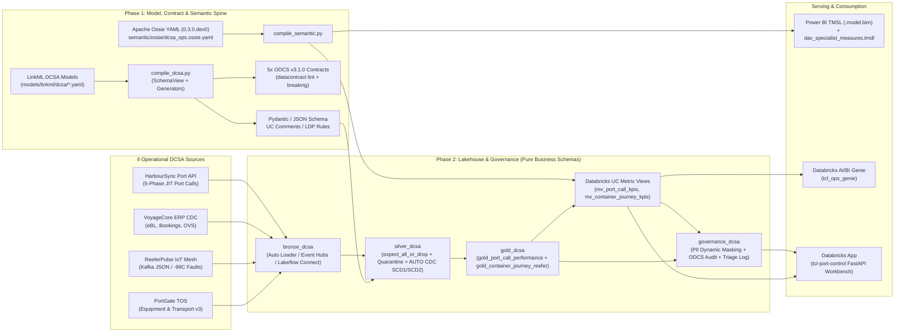

# Tasman Container Line (TCL) — DCSA Contract-and-Model-Driven Lakehouse Lab

Executable maritime reference lakehouse demonstrating **Low-Toil Governed Data Architecture** from canonical **LinkML DCSA** domain models through **ODCS v3.1.0** data contracts, **Lakeflow Declarative Pipelines**, **Apache Ossie** dual semantic compilation (Databricks Unity Catalog Metric Views + Power BI `.model.bim`), **AI/BI Genie**, and a native **Databricks FastAPI Workbench** (`tcl-port-control`).

---

## Architecture



---

## Low-Toil Governed Lakehouse Principles

- **Zero Hand-Duplicated Rules:** Schema validation (Pydantic), ingestion/silver expectations (`generated/ldp_expectations.json`), Unity Catalog column metadata + PII classification (`generated/uc_comments.json`), and all 5 ODCS v3.1.0 contracts (`contracts/odcs/*.odcs.yaml`) compile mechanically from LinkML via `SchemaView`.
- **Pure Subject Schemas Only:** All Lakehouse objects target `bronze_dcsa`, `silver_dcsa`, `gold_dcsa`, and `governance_dcsa` directly (`workspace` catalog for Free Edition; parameterized `${catalog}` for Staging/Prod) — never `dev_` schema prefixes.
- **Consolidated Edge Limits (Free Edition Safe):** Single serverless Lakeflow Declarative Pipeline (`dcsa_medallion_pipeline`) using modern `from pyspark import pipelines as dp`, and a single Databricks App (`tcl-port-control`).
- **80/20 Semantic Portability & Governance Split:** Portable KPI definitions live in [`semantic/ossie/dcsa_ops.ossie.yaml`](semantic/ossie/dcsa_ops.ossie.yaml); complex Power BI DAX time-intelligence lives cleanly in [`semantic/powerbi_overrides/`](semantic/powerbi_overrides/README.md); `shipper_contact_email` uses a single Unity Catalog Dynamic Data Masking function (`mask_pii_email`).

---

## Deployment Modes: Free Edition vs Azure Enterprise

| Layer / Source | `free_edition` (`dev` target, `catalog=workspace`) | `azure_enterprise` (`staging` / `prod` targets) |
| :--- | :--- | :--- |
| **PortGate TOS** | Serverless Job synthetic JSONL -> UC Volume + Auto Loader `cloudFiles` | Azure Landing Zone ADLS / UC Volume + Auto Loader `cloudFiles` |
| **ReeferPulse IoT Mesh** | Kafka JSON envelopes in UC Volume -> Auto Loader `cloudFiles` | `spark.readStream.format("kafka")` -> Azure Event Hubs SASL_SSL |
| **VoyageCore ERP CDC** | CDC JSONL (`INSERT`/`UPDATE`/`DELETE` + out-of-order) -> `cloudFiles` + `AUTO CDC` | Lakeflow Connect Managed Bronze CDC -> `AUTO CDC` SCD1 / SCD2 |
| **HarbourSync Port API** | Serverless Python Job -> UC Volume + Auto Loader `cloudFiles` | Serverless Python Job (Port Authority API poll) -> UC Volume + `cloudFiles` |
| **Compute & Catalog** | Serverless LDP + Jobs + `workspace` catalog | Serverless LDP + Jobs + `tcl_staging` / `tcl_prod` catalogs |

---

## Quickstart

### 1. Initialize Environment (`uv`)
```bash
./setup.sh
```

### 2. Compile, Lint Contracts & Run All Tests
```bash
./run.sh
```

### 3. Generate Sample Operational Data Locally
```bash
uv run python -m generators.dcsa_synthetic_generator --output-dir data/sample_landing
```

### 4. Launch Port Control Workbench Locally (Demo Mode)
```bash
./run.sh --serve-app
# Open http://127.0.0.1:8000 in browser
```

---

## Live Databricks Free Edition Verification

Verified end-to-end against Databricks Free Edition (`dev` target, `catalog=workspace`, warehouse supplied via runtime CLI `--var`) with zero `dev_` schema prefixes:

- **End-to-End Orchestrator (`tcl_dcsa_e2e_orchestrator`, run `1002918074181118`)**: All 5 serverless/pipeline tasks finished **`TERMINATED / SUCCESS`** in sequence:
  1. `bootstrap_uc_objects` (`run_id=668779479510169`) — pure schemas (`bronze_dcsa`, `silver_dcsa`, `gold_dcsa`, `governance_dcsa`), UC Volumes, and governance tables
  2. `ingest_harboursync_jit` (`run_id=281430197022506`) — 4 DCSA operational landing feeds in UC Volumes
  3. `run_dcsa_medallion_pipeline` (`run_id=408750898674992`) — consolidated Serverless LDP (`dcsa_medallion_pipeline`)
  4. `deploy_serving_governance` (`run_id=749963866402415`) — UC Metric Views DDL, LinkML UC comments (`COMMENT ON TABLE` / `COMMENT ON VIEW`), and Silver PII dynamic data mask
  5. `run_contract_tests` (`run_id=651874174526977`) — live `datacontract-cli` validation persisted to `governance_dcsa.contract_test_results`
- **Live Metric View KPIs (`MEASURE(...)`)**:
  - `workspace.gold_dcsa.mv_port_call_kpis`: verified across all 6 Tasman/Pacific ports (`AUBNE`, `AUSYD`, `FJSVA`, `NZAKL`, `NZLYT`, `NZTRG`; **15 port calls**, **12 on-time**).
  - `workspace.gold_dcsa.mv_container_journey_kpis`: **30 container moves** across all 6 ports, `active_ebl_count = 1` per port, capturing cold-chain reefer excursions on `NZLYT` (`2/8 = 25%`) and `NZTRG` (`2/4 = 50%`).
- **Silver Quarantine & `AUTO CDC` Proof**:
  - Quarantine routing captured deliberate bad payloads with per-rule violation reasons: `quarantine_portgate_equipment_events = 2` (invalid container ID + UN/LOCODE) and `quarantine_reeferpulse_iot_telemetry = 1` (`-99.0C` sensor fault).
  - Out-of-order CDC + `DELETE` reconciliation produced **`silver_dcsa_ebl_current = 14`** (SCD Type 1) vs **`silver_dcsa_ebl_history = 31`** (SCD Type 2).
- **Native `spark_ibis` ODCS Execution**: All 5 ODCS v3.1.0 contracts executed natively on Serverless via `spark_ibis` and passed **420/420 checks (`0` failures)**:
  - `tcl-gold-dcsa-port-call-kpis`: `57/57` (`gold_port_call_performance`)
  - `tcl-harboursync-jit-port-calls`: `55/55` (`silver_harboursync_jit_port_calls`)
  - `tcl-portgate-tos-events`: `112/112` (`silver_portgate_equipment_events`, `silver_portgate_transport_events`)
  - `tcl-reeferpulse-iot-telemetry`: `71/71` (`silver_reeferpulse_iot_telemetry`)
  - `tcl-voyagecore-ebl-bookings`: `125/125` (`silver_dcsa_ebl_current`, `silver_voyagecore_bookings`, `silver_voyagecore_carrier_schedules`)
- **PII Dynamic Masking, Databricks App & Genie Space**:
  - `SELECT transport_document_reference, shipper_contact_email FROM workspace.silver_dcsa.silver_dcsa_ebl_current` returned masked addresses (`ex***@tasman-shipper.example`).
  - `tcl-port-control` FastAPI App deployed and verified (`app_status: RUNNING`, `compute_status: ACTIVE`, active deployment `SUCCEEDED`), alongside the live `TCL DCSA Port & Reefer Operations Genie` Space (`space_id: 01f1e8a9d75210eebed8df45562470e2`).

### Empirical Databricks Serverless & Free Edition Notes

1. **Serverless `spark_python_task` execution model**: Databricks Serverless executes Python script tasks inside an IPython `exec(...)` wrapper where `raise SystemExit(0)` marks a task failed and `__file__` is undefined — job entrypoints exit cleanly by returning `0` (raising `SystemExit` only on non-zero failures) and resolve project roots via `_resolve_project_root()` with `Path.cwd()` fallback.
2. **Spark SQL `RLIKE` string literal escaping**: `compile_dcsa.py` doubles backslashes in `RLIKE` predicates (`\\s`, `\\.`) so `generated/ldp_expectations.json` preserves regex character classes in Spark SQL instead of stripping backslashes.
3. **Native `datacontract-cli` on Serverless (`spark_ibis`)**: Requires unqualified ODCS `physicalName` (since `servers[0].schema` selects the UC schema), `pandas>=2.1,<3.0` (avoiding `pandas 3.x` `OptionError: No such option` in `ibis`), and omitting `ibis-framework[pyspark]` from job dependencies so PyPI `pyspark` never shadows Serverless managed `databricks-connect` and detaches the REPL.
4. **Power BI compilation without Windows/.NET TOM**: `compile_semantic.py` generates `generated/powerbi/dcsa_ops.model.bim` (TMSL with 10 DAX measures) natively on Linux; `ossie-microsoft --pbip` exits non-zero unless the optional `tom` extra (`apache-ossie-microsoft[tom]`) is installed.

---

## Build Log

- **2026-11-25 - Phase 1 Model, Contract & Semantic Spine** - Bootstrapped `uv` Python 3.12 environment, authored 5 LinkML DCSA domain models (`dcsa_common`, `dcsa_tnt_v3`, `dcsa_ebl_v3`, `dcsa_jit_v1`, `dcsa_enterprise`), compiled 5 valid ODCS v3.1.0 contracts + Pydantic/JSON Schema/UC/LDP artifacts, verified `datacontract changelog`/`breaking`, authored `semantic/ossie/dcsa_ops.ossie.yaml` (`0.3.0.dev0`), compiled Databricks Metric Views SQL DDL and Power BI `dcsa_ops.model.bim` (10 DAX measures), and verified `pytest` + `ruff`.
- **2026-11-25 - Phase 2 Sources, LDP Pipeline, Jobs, App, DABs & CI/CD** - Built deterministic NZ/AU/Pacific DCSA generator across all 4 sources (with deliberate quarantine and out-of-order CDC test cases); implemented modern `pyspark.pipelines` medallion pipeline (`free_edition` and `azure_enterprise` ingestion, dynamic `expect_all_or_drop` + quarantine tables, `AUTO CDC` SCD1/SCD2, Gold KPI marts matching Ossie schema); added serverless UC bootstrap, ingestion, serving/PII-masking governance, and live `DataContract.test()` jobs; built `apps/port-control` FastAPI workbench, Genie Space config, `direct`-engine DABs bundle (`databricks.yml` + `resources/*.yml`), GitHub Actions & Azure Pipelines CI/CD workflows, `SECURITY.md`, MIT `LICENSE`, and Phase 2 test suite.
- **2026-11-26 - Phase 3 & 4 Live Databricks Free Edition Verification & CI/CD Hardening** - Verified end-to-end 5-task orchestrator run `1002918074181118` (all tasks `SUCCESS`, `420/420` native `spark_ibis` ODCS checks, 6 live SQL proofs, live `tcl-port-control` App and Genie Space), aligned ODCS contracts to curated `silver_dcsa`/`gold_dcsa` tables with Silver-only PII masking, expanded repository hygiene gates, and published private GitHub repository with green GitHub Actions CI.
