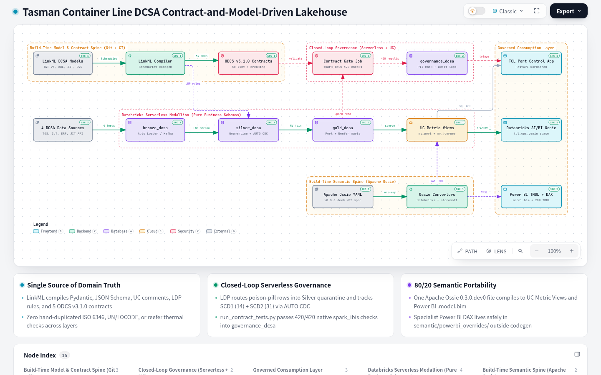
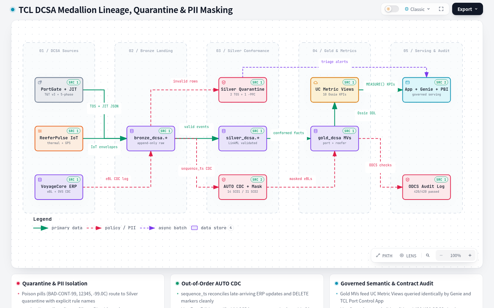
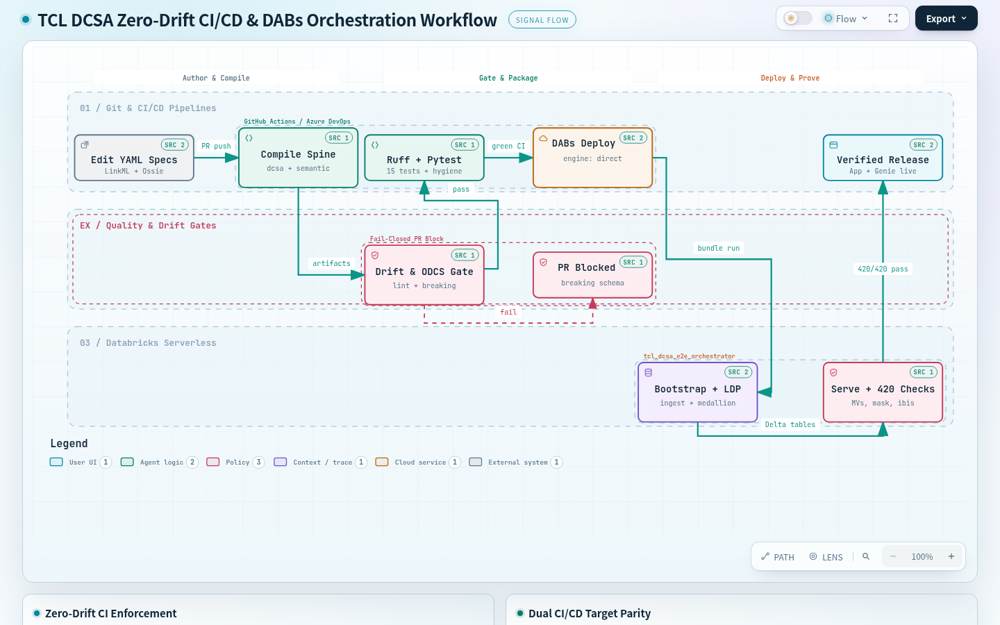
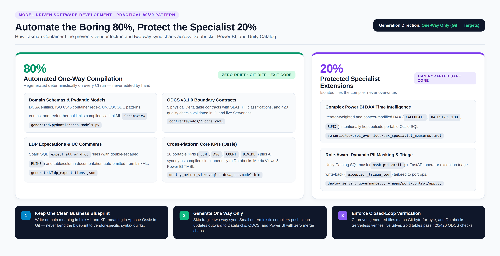

# Architecture Deep Dive — Tasman Container Line (TCL) Lakehouse

> [!NOTE]
> **Fictional Scenario Notice:** **Tasman Container Line (TCL)** and all four operational source systems (**PortGate TOS**, **ReeferPulse IoT Mesh**, **VoyageCore ERP**, **HarbourSync Port API**) are **100% fictional** and backed by synthetic data generated exclusively for this open-source reference architecture.

This document details the architectural design, control ownership, data boundaries, and engineering trade-offs behind the **Tasman Container Line (TCL) DCSA Contract- and Model-Driven Lakehouse**.

---

## 1. End-to-End Platform &amp; Closed-Loop Governance

  

*(Interactive standalone diagram with clickable GitHub source citations: [`diagrams/tcl-platform-architecture.html`](diagrams/tcl-platform-architecture.html))*

### Two-Track Architectural Separation

A core design decision in this repository is strictly separating **build-time compilation** from **runtime execution**:

1. **Build-Time Compilation Track (Git + CI Runners — Zero Spark Cluster Dependencies):**
   - [`src/tcl_compiler/compile_dcsa.py`](../src/tcl_compiler/compile_dcsa.py) loads [`models/linkml/dcsa/dcsa_enterprise.yaml`](../models/linkml/dcsa/dcsa_enterprise.yaml) via `linkml_runtime.utils.schemaview.SchemaView` and deterministically emits:
     - [`generated/pydantic/dcsa_models.py`](../generated/pydantic/dcsa_models.py) — Pydantic v2 runtime/test models (with portable relative `source_file` normalization so CI never drifts across machines).
     - [`generated/jsonschema/dcsa_schema.json`](../generated/jsonschema/dcsa_schema.json) — canonical JSON Schema.
     - [`generated/uc_comments.json`](../generated/uc_comments.json) — Unity Catalog table/column documentation and PII annotations.
     - [`generated/ldp_expectations.json`](../generated/ldp_expectations.json) — Spark SQL boolean validation predicates (derived directly from LinkML `required`, `pattern`, `minimum_value`, `maximum_value`, and `enum` definitions, with Spark SQL `RLIKE` double-backslash escaping).
     - Five ODCS v3.1.0 contracts under [`contracts/odcs/`](../contracts/odcs/) aligned to curated `silver_dcsa` and `gold_dcsa` Unity Catalog tables.
   - [`src/tcl_compiler/compile_semantic.py`](../src/tcl_compiler/compile_semantic.py) compiles [`semantic/ossie/dcsa_ops.ossie.yaml`](../semantic/ossie/dcsa_ops.ossie.yaml) (`0.3.0.dev0`) one-way using official upstream Apache converters:
     - `ossie-databricks deploy` → [`generated/databricks/metric_views/*.yaml`](../generated/databricks/metric_views/) + parameterized [`generated/databricks/deploy_metric_views.sql`](../generated/databricks/deploy_metric_views.sql).
     - `ossie-microsoft export` → [`generated/powerbi/dcsa_ops.model.bim`](../generated/powerbi/dcsa_ops.model.bim) (2 tables, 1 star-schema relationship, 10 translated DAX measures, `0` `BLANK()` fallbacks).

2. **Runtime Execution Track (Databricks Serverless Compute — Unity Catalog Managed):**
   - Pure business subject schemas (`bronze_dcsa`, `silver_dcsa`, `gold_dcsa`, `governance_dcsa`) live inside the target catalog (`workspace` in Free Edition `dev`; `tcl_staging` / `tcl_prod` in Azure Enterprise).
   - No LinkML or Ossie converter libraries are installed on Spark clusters — Serverless jobs consume only lightweight compiled JSON/YAML/SQL artifacts synced automatically via DABs.

---

## 2. Medallion Lineage, Quarantine &amp; PII Masking

  

*(Interactive standalone diagram: [`diagrams/tcl-medallion-dataflow.html`](diagrams/tcl-medallion-dataflow.html))*

### Dual-Mode Bronze Ingestion (`bronze_ingestion.py`)

[`src/pipelines/dcsa_medallion/bronze_ingestion.py`](../src/pipelines/dcsa_medallion/bronze_ingestion.py) switches cleanly via pipeline Spark configuration `tcl.ingestion_mode`:

- **`free_edition` (default for `dev`):** All 4 DCSA operational feeds land JSONL payloads (including Kafka-style envelopes for ReeferPulse IoT and out-of-order CDC records for VoyageCore ERP) into governed Unity Catalog Volumes (`/Volumes/<catalog>/bronze_dcsa/landing_*`) ingested via Auto Loader (`cloudFiles`).
- **`azure_enterprise` (`staging` / `prod`):**
  - **ReeferPulse IoT Mesh** switches to `spark.readStream.format("kafka")` targeting Azure Event Hubs' Kafka-compatible `SASL_SSL` endpoint (avoiding unsupported third-party Event Hubs JVM connectors inside LDP).
  - **VoyageCore ERP** switches to Lakeflow Connect managed Bronze CDC tables.
  - Downstream Bronze→Silver→Gold logic remains **100% identical** in both modes.

### Contract-Driven Silver Conformance, Quarantine &amp; `AUTO CDC` (`silver_conformance.py`)

[`src/pipelines/dcsa_medallion/silver_conformance.py`](../src/pipelines/dcsa_medallion/silver_conformance.py) uses the modern `from pyspark import pipelines as dp` API:

- **Dynamic Expectation Enforcement:** [`expectations_loader.py`](../src/pipelines/dcsa_medallion/expectations_loader.py) loads `generated/ldp_expectations.json` and attaches `@dp.expect_all_or_drop(...)` to every Silver table — zero manually repeated validation rules.
- **Explicit Quarantine Routing:** Companion quarantine streaming tables (`quarantine_portgate_equipment_events`, `quarantine_portgate_transport_events`, `quarantine_reeferpulse_iot_telemetry`, `quarantine_harboursync_jit_port_calls`, `quarantine_voyagecore_transport_documents`) evaluate the exact negated expectation predicate and populate `quarantine_reason` with semicolon-delimited violated rule names.
  - Verified live on Free Edition: `2` PortGate rows (`BAD-CONT-99`, `12345`) and `1` ReeferPulse sensor fault (`-99.0°C`) quarantined cleanly while valid events flowed downstream.
- **Out-of-Order `AUTO CDC` (SCD Type 1 &amp; SCD Type 2):**
  - `dp.create_auto_cdc_flow` consumes validated VoyageCore eBL CDC events ordered by `sequence_ts` with `apply_as_deletes=F.expr("cdc_operation = 'DELETE'")`.
  - Produces both `silver_dcsa.silver_dcsa_ebl_current` (`stored_as_scd_type=1`, **14 live rows**) and `silver_dcsa.silver_dcsa_ebl_history` (`stored_as_scd_type=2`, **31 live audit rows**).

### Gold Materialized Views &amp; Unity Catalog Metric Views (`gold_marts.py`)

[`src/pipelines/dcsa_medallion/gold_marts.py`](../src/pipelines/dcsa_medallion/gold_marts.py) materializes two Gold analytical tables whose schemas match [`semantic/ossie/dcsa_ops.ossie.yaml`](../semantic/ossie/dcsa_ops.ossie.yaml) column-for-column:

1. `gold_dcsa.gold_port_call_performance` — joins HarbourSync 5-phase JIT timestamps (`ATA_PBP`, `ATB_BERTH`, `ATD_BERTH`) against VoyageCore OVS planned arrival schedules to compute `on_time_flag`, `port_turnaround_hours`, and `berth_wait_hours`.
2. `gold_dcsa.gold_container_journey_reefer` — joins PortGate container moves, ReeferPulse thermal excursion indicators, and active SCD1 eBL references to compute `dwell_hours` and `excursion_flag_int`.

[`src/jobs/deploy_serving_governance.py`](../src/jobs/deploy_serving_governance.py) deploys [`generated/databricks/deploy_metric_views.sql`](../generated/databricks/deploy_metric_views.sql) (`CREATE OR REPLACE VIEW ${catalog}.gold_dcsa.<mv> WITH METRICS LANGUAGE YAML AS $$ ... $$;`), binds UC table/view comments, and registers `<catalog>.governance_dcsa.mask_pii_email` exclusively on curated Silver eBL tables.

---

## 3. Closed-Loop ODCS Governance &amp; CI/CD Orchestration

  

*(Interactive standalone diagram: [`diagrams/tcl-cicd-orchestration.html`](diagrams/tcl-cicd-orchestration.html))*

### Dual-Stage Verification

1. **Build-Time PR Gates (GitHub Actions / Azure DevOps):**
   - Recompiles LinkML and Apache Ossie and enforces `git diff --exit-code generated contracts` (zero silent drift).
   - Runs `datacontract lint` across all 5 ODCS v3.1.0 files.
   - Runs `datacontract breaking` against a breaking fixture (`tests/fixtures/reeferpulse_iot_telemetry_breaking.odcs.yaml`) to prove CI fails closed on column drops or type narrowings.
   - Executes `ruff check .` and `pytest -v` (including automated repo hygiene and zero-Mermaid assertions).
2. **Post-Deploy Serverless Quality Gate (`run_contract_tests.py`):**
   - Runs as Task 5 of `tcl_dcsa_e2e_orchestrator` (and standalone via `tcl_contract_quality_gate`).
   - Rewrites `servers[*].catalog` dynamically for the target environment, executes `DataContract(data_contract_file=..., spark=spark).test()` natively on Databricks Serverless via `spark_ibis` (with an automatic DuckDB fallback path if Spark Connect ever rejects a check), and appends structured audit rows to `<catalog>.governance_dcsa.contract_test_results`.
   - Verified live: **420 / 420 checks passed (`0` failures)** across all 5 contracts.

---

## 4. Consumption Surfaces &amp; 80/20 Protection

  

- **Databricks Native App (`apps/port-control/`):** FastAPI + Tailwind operational cockpit (`tcl-port-control`) querying `MEASURE(...)` KPIs from Unity Catalog Metric Views, inspecting Silver quarantine and reefer excursions, calling the Databricks Genie Conversation API (`/api/genie/ask`), and writing operator triage dispositions back to `<catalog>.governance_dcsa.exception_triage_log` (`/api/triage`). Supports deterministic offline demo mode for local development and automated `httpx` tests.
- **Databricks AI/BI Genie (`src/genie/tcl_ops_genie.geniespace.json`):** Managed declaratively via DABs (`bundle.engine: direct` + `resources/genie_spaces.yml`), bound directly to `mv_port_call_kpis`, `mv_container_journey_kpis`, and Gold tables with curated DCSA instructions and SQL snippets.
- **Power BI Semantic Model (`generated/powerbi/dcsa_ops.model.bim` + `semantic/powerbi_overrides/`):** Receives the exact same 10 core KPIs compiled from Apache Ossie while isolating advanced evaluation-context DAX (`CALCULATE`, `DATESINPERIOD`, `SUMX`) in `dax_specialist_measures.tmdl`.
