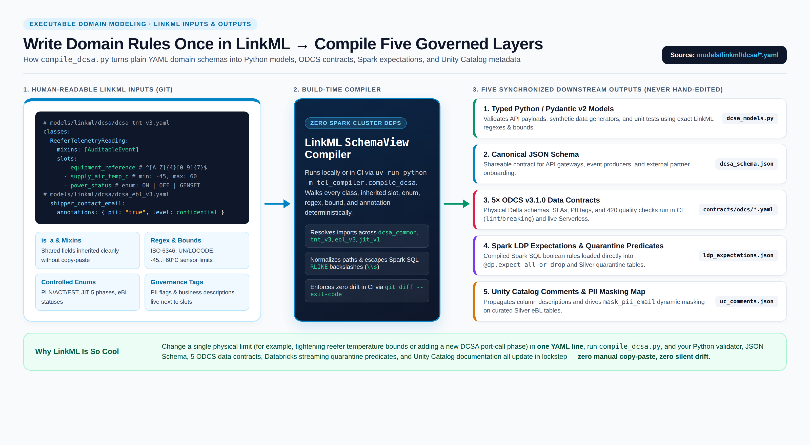
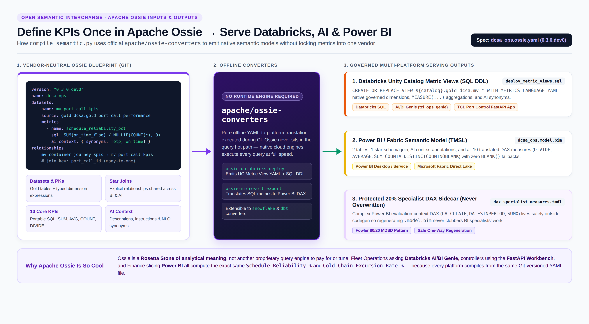

# Concepts Explained: DCSA, LinkML, Apache Ossie &amp; Cross-Industry Portability

> [!NOTE]
> **New to container shipping, LinkML, or Apache Ossie?** Start here. Even if you work in **healthcare, banking, retail, telecom, or energy**, this guide explains *what* each open standard does, *why* combining them is such a superpower, and *how* to transplant this exact end-to-end Lakehouse pipeline into your own industry by swapping only the YAML blueprints.

---

## 1. What Is DCSA (and Why Does It Matter)?

**DCSA** stands for the **Digital Container Shipping Association** ([dcsa.org](https://dcsa.org/)) — a neutral, non-profit standards body established by the world's largest ocean container carriers to publish open, vendor-neutral digital standards for container shipping.

### Why DCSA Is Useful
Before open standards like DCSA, moving one refrigerated container from Auckland to Brisbane meant translating dozens of proprietary carrier spreadsheets, legacy EDIFACT messages, custom terminal webhooks, and incompatible port-authority timestamps. Every bilateral integration had to be custom-engineered and broke whenever a partner renamed a field.

DCSA gives the entire maritime ecosystem a **shared, canonical vocabulary**:
- **Track &amp; Trace (T&amp;T v3.0 with IoT/Reefer visibility):** Standardized `EquipmentEvent`, `TransportEvent`, and smart-container thermal telemetry (`ISO 6346` container IDs, `UN/LOCODE` ports, `PLN`/`ACT`/`EST` event classifiers).
- **Electronic Bill of Lading (eBL v3):** Standardized digital shipping title documents and workflow state transitions (`DRFT` → `APPR` → `ISSU` → `SURR`).
- **Just-in-Time (JIT) Port Call:** Five harmonized vessel arrival/berthing milestones (`ETA_PBP`, `ATA_PBP`, `ETB_BERTH`, `ATB_BERTH`, `ATD_BERTH`) so ships can adjust speed ("virtual arrival") instead of burning fuel waiting at anchor.
- **Operational Vessel Schedules (OVS):** Shared planned vs. actual sailing schedules so carriers, terminals, and cargo owners measure reliability consistently.

### How DCSA Compares to Open Domain Standards in Other Industries

DCSA plays the **exact same role in maritime logistics** that mature interoperability standards play in other major sectors:

| Industry | Equivalent Open Standard | What It Standardizes | Direct Analogy to DCSA in This Lab |
| :--- | :--- | :--- | :--- |
| **Maritime Shipping** *(This Lab)* | **DCSA** (T&amp;T v3, eBL, JIT, OVS) | Container events, reefer IoT, Bills of Lading, vessel port calls | `EquipmentEvent`, `ReeferTelemetryReading`, `TransportDocument`, `PortCallTimestamp` |
| **Healthcare** | **HL7 FHIR** | Patients, encounters, lab observations, ICU vitals, clinical orders | `Observation` (vitals/bounds) ↔ `ReeferTelemetryReading`; `Encounter` ↔ `PortCallTimestamp` |
| **Banking &amp; Payments** | **ISO 20022** / **BIAN** | Payment initiation (`pacs.008`), settlement status, account domains | `IBAN`/`BIC` regex validation ↔ `ISO 6346`/`UN/LOCODE`; Payment lifecycle ↔ `eBL` CDC |
| **Retail &amp; CPG Supply Chain** | **GS1 / EPCIS 2.0** | `GTIN` product IDs, warehouse/store scans, cold-chain shelf telemetry | `GTIN`/`GLN` codes ↔ `EquipmentReference`/`UNLocationCode`; Freezer IoT ↔ `ReeferPulse` |
| **Energy &amp; Grid Utilities** | **IEC CIM** (Common Info Model) | Substations, smart-meter telemetry, grid outages, market dispatch | Smart-meter bounds &amp; outage milestones ↔ Reefer telemetry &amp; JIT berth phases |
| **Telecommunications** | **TM Forum Open APIs / SID** | Customer accounts, network alarms, service orders, SLA metrics | Network QoS events ↔ `EquipmentEvent`; Service Order CDC ↔ `VoyageCore ERP` |
| **Insurance** | **ACORD** | Policies, claims lifecycles, underwriting attributes, PII parties | Claim state CDC (SCD2 audit trail) ↔ `silver_dcsa_ebl_history` |

---

## 2. What Is LinkML (and Why Is It Such a Cool Idea)?

**LinkML** (*Linked Data Modeling Language*, [linkml.io](https://linkml.io/)) is an open-source YAML modeling framework designed to express **logical domain schemas** cleanly — complete with class inheritance (`is_a`), reusable `mixins`, enums, regex patterns, physical numeric ranges, and governance annotations (`pii`, `classification`).

### Why LinkML Beats Traditional Data Modeling Tools
Most teams suffer from a painful split:
- **Architects draw diagrams or wikis** that go stale within two weeks because nothing executes them.
- **Engineers hand-code the same rules five times** — once in Pydantic, once in JSON Schema, once in Spark SQL quality checks, once in ODCS data contracts, and once in Unity Catalog comments.

**LinkML turns your logical domain model into an executable compiler input.** Using `SchemaView` inside [`src/tcl_compiler/compile_dcsa.py`](../src/tcl_compiler/compile_dcsa.py), one YAML edit updates **five synchronized downstream layers** automatically:

  

*(High-resolution interactive source: [`infographics/tcl_linkml_io.html`](infographics/tcl_linkml_io.html))*

**Why engineers love this pattern:**
1. **Readable by business &amp; technical reviewers alike:** A PR diff on `models/linkml/dcsa/dcsa_tnt_v3.yaml` is plain English YAML — domain leads can actually review `minimum_value: -45` or `pii: "true"` directly in GitHub!
2. **Zero rule drift by construction:** GitHub Actions runs `compile_dcsa.py` + `git diff --exit-code generated contracts`. If someone edits a generated contract or forgets to recompile after updating a LinkML slot, CI fails closed immediately.
3. **Governance shifts left:** Marking `shipper_contact_email` with `pii: "true"` in LinkML propagates automatically into ODCS contracts, Unity Catalog metadata, and Silver dynamic data masking (`mask_pii_email`).

---

## 3. What Is Apache Ossie (and Why Is It Such a Cool Idea)?

**Apache Ossie** (*Open Semantic Interchange*, [ossie.apache.org](https://ossie.apache.org/)) is an open, vendor-neutral YAML specification for **analytical semantic models** — defining datasets, primary keys, star-schema joins, governed KPI formulas, and `ai_context` synonyms/instructions cleanly in Git.

### The Problem Ossie Solves: Semantic Fragmentation
Even after you build clean Gold Delta tables, metrics quietly fracture across consumption tools:
- **Databricks SQL** defines `Schedule Reliability %` as `arrival_delay <= 120 min`.
- **Power BI DAX** excludes cancelled calls differently.
- **AI assistants** invent their own joins and denominators on the fly.

**Apache Ossie acts as a Rosetta Stone of analytical meaning.** Crucially, Ossie is **not** another query engine sitting in your hot path — it is a **pure offline interchange spec** compiled one-way by official [`apache/ossie-converters`](https://github.com/apache/ossie-converters) into each platform's native runtime:

  

*(High-resolution interactive source: [`infographics/tcl_ossie_io.html`](infographics/tcl_ossie_io.html))*

**Why this pattern is genuinely cool:**
1. **Zero query overhead:** Databricks executes native Unity Catalog Metric Views (`MEASURE(...)`) on Serverless SQL; Power BI executes native DAX inside `.model.bim`. Ossie compiles at build time and gets completely out of the way at runtime.
2. **BI and AI share one brain:** Databricks AI/BI Genie (`tcl_ops_genie`), the `tcl-port-control` FastAPI App, and Power BI all inherit the exact same formulas, joins, and synonyms from [`semantic/ossie/dcsa_ops.ossie.yaml`](../semantic/ossie/dcsa_ops.ossie.yaml).
3. **80/20 pragmatism instead of lowest-common-denominator lock-in:** Ossie automates the boring 80% (tables, keys, relationships, core `SUM`/`AVG`/`COUNT`/`DIVIDE` KPIs), while complex Power BI-specific DAX (`CALCULATE`, `DATESINPERIOD`, `SUMX`) stays safely protected in [`semantic/powerbi_overrides/dax_specialist_measures.tmdl`](../semantic/powerbi_overrides/dax_specialist_measures.tmdl) — never clobbered on regeneration.

---

## 4. Shifting This Exact Pipeline From Shipping to Any Other Industry

The biggest secret of a **Contract- and Model-Driven Lakehouse** is that **~90% of the platform engineering is completely industry-agnostic**.

When you move this architecture from Tasman Container Line (Shipping) to Healthcare, Banking, Retail, or Energy:
- **What stays 100% unchanged:** `compile_dcsa.py` (`SchemaView` pattern), `datacontract-cli` CI/Serverless quality gates, Lakeflow Declarative Pipelines (Auto Loader, Event Hubs Kafka, `expect_all_or_drop`, Quarantine tables, `AUTO CDC` SCD1/SCD2), `compile_semantic.py` (`ossie-databricks` + `ossie-microsoft`), Unity Catalog pure-subject schemas + dynamic PII masking, DABs (`engine: direct`), FastAPI Workbench + Genie pattern, and GitHub Actions / Azure DevOps CI/CD.
- **What you swap (~10%):** Your **LinkML domain YAML** (`models/linkml/<industry>/`), your **Apache Ossie KPI YAML** (`semantic/ossie/<industry>_ops.ossie.yaml`), and your Gold mart joins!

### Cross-Industry Blueprint Translation Matrix

| Architectural Slot | Shipping *(This Repo — DCSA)* | Healthcare *(HL7 FHIR)* | Banking &amp; Payments *(ISO 20022)* | Cold-Chain Retail *(GS1 / EPCIS 2.0)* | Energy &amp; Utilities *(IEC CIM)* |
| :--- | :--- | :--- | :--- | :--- | :--- |
| **Source 1 (Webhooks / Files)** | `PortGate TOS` container gate events | EHR ADT admit/discharge webhooks | Card / Wire gateway ISO 20022 XML/JSON | Warehouse &amp; POS EPCIS scan drops | Field crew work-order &amp; outage drops |
| **Source 2 (IoT / Streaming)** | `ReeferPulse` container temps (`-45..+60°C`) | ICU bedside monitor vitals (SpO2, HR) | Real-time fraud scoring telemetry | Store freezer / chiller IoT probes | Smart-meter &amp; substation SCADA streams |
| **Source 3 (OLTP CDC — SCD1/SCD2)** | `VoyageCore ERP` eBL &amp; booking states | Patient / Claims master DB CDC | Core Banking account &amp; KYC ledger CDC | ERP SKU, supplier &amp; price master CDC | Customer billing &amp; tariff master CDC |
| **Source 4 (Partner REST API)** | `HarbourSync` 5-phase JIT port calls | Lab / Pharmacy turnaround API | Clearing house settlement window API | 3PL carrier ETA &amp; dock-door API | Wholesale grid market dispatch API |
| **LinkML Regex &amp; Bounds → Quarantine** | `ISO 6346`, `UN/LOCODE`, `-99.0°C` fault | `NHI`/`MRN` ID regex, `SpO2 > 100%` fault | `IBAN`/`BIC` regex, negative fee fault | `GTIN-14` check pattern, `-99°C` probe | Meter serial regex, impossible kV spike |
| **Silver PII / PHI Dynamic Mask** | `shipper_contact_email` (`mask_pii_email`) | `patient_email` / `national_health_id` | `account_holder_email` / `tax_id` | `supplier_contact_email` / `loyalty_id` | `customer_email` / `premise_address` |
| **Apache Ossie Core KPIs (UC + Power BI)** | Schedule Reliability %, Cold-Chain Excursion %, Turnaround Hrs | 30-Day Readmission %, Avg ED Wait Hrs, ICU Alert Rate % | STP Settlement %, Fraud Excursion %, Avg Clearing Latency ms | On-Shelf Availability %, Cold-Chain Shrink %, DC Dwell Hrs | SAIDI Outage Mins, Grid Reliability %, Peak Load Factor % |
| **Operational Databricks App** | `tcl-port-control` (Port &amp; Reefer Triage) | Clinical Bed &amp; ICU Alert Workbench | Payment Exception &amp; Fraud Triage Desk | Store Cold-Chain &amp; Stockout Cockpit | Grid Outage &amp; Substation Triage Desk |

### How to Fork This Repo for Your Own Industry in 5 Steps
1. **Replace `models/linkml/`** with your industry's canonical entities, regexes, bounds, and PII/PHI annotations (e.g., FHIR `Patient`/`Observation` or ISO 20022 `PaymentInstruction`).
2. **Run `compile_dcsa.py`** to auto-generate your Pydantic models, JSON Schema, ODCS v3.1.0 boundary contracts, Unity Catalog comments, and Spark LDP expectations.
3. **Update `src/pipelines/` Gold joins** to aggregate your Silver conformed facts into your Gold analytical marts.
4. **Replace `semantic/ossie/`** with your domain KPIs + AI synonyms and run `compile_semantic.py` to emit native Databricks UC Metric Views + Power BI `.model.bim`.
5. **Run `./run.sh` and `./scripts/deploy_free_edition.sh --deploy-app`** — your entire contract-checked Lakehouse, AI/BI Genie Space, and operational Exception Workbench are live!
