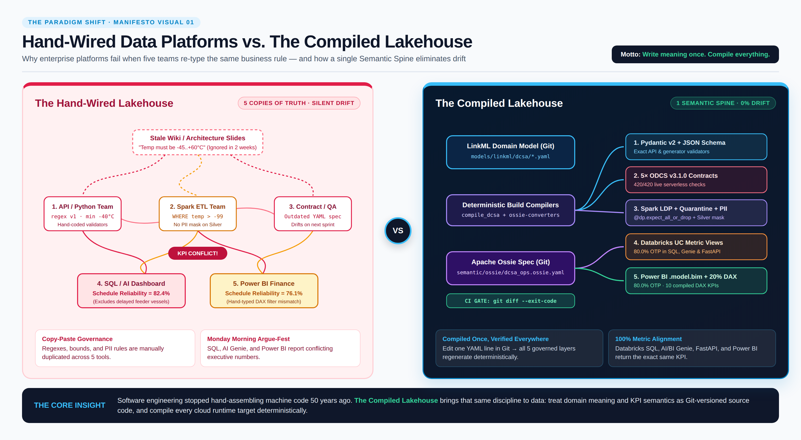
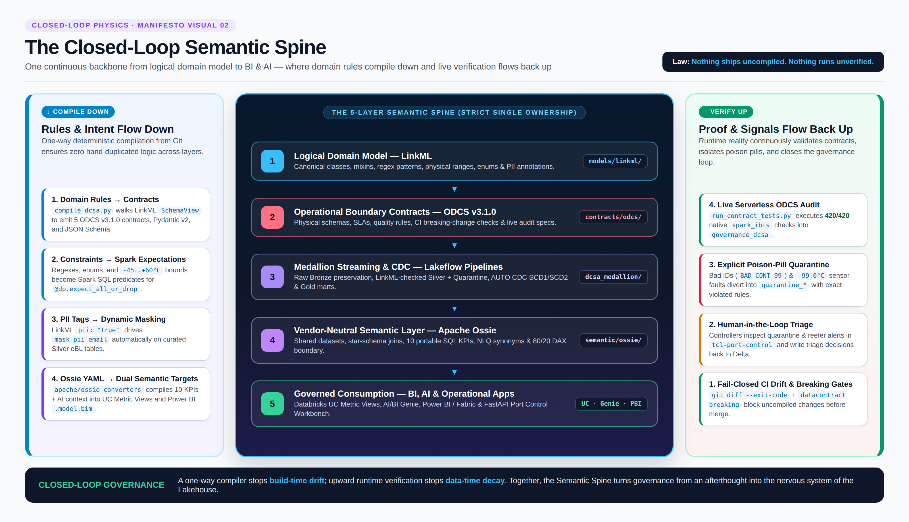
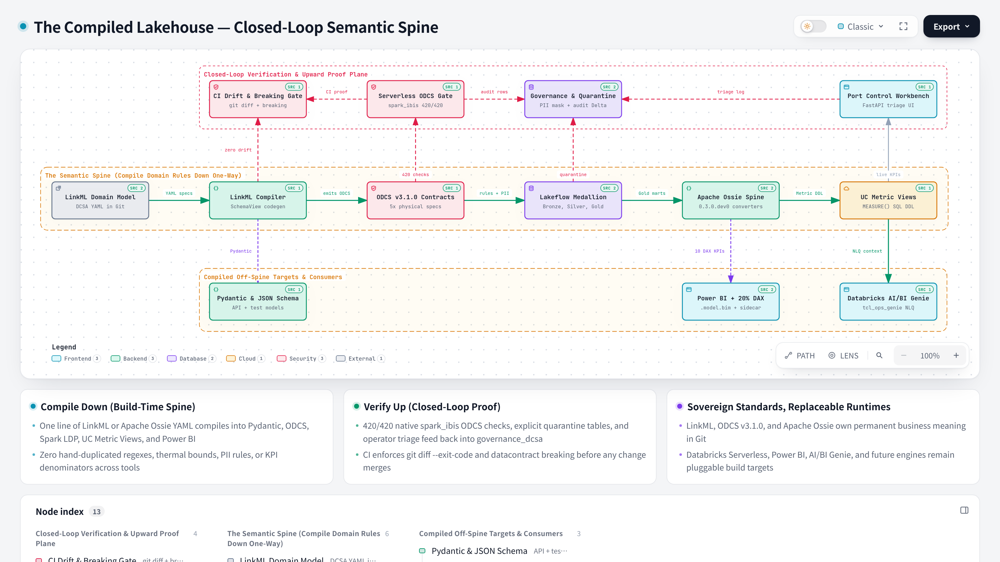
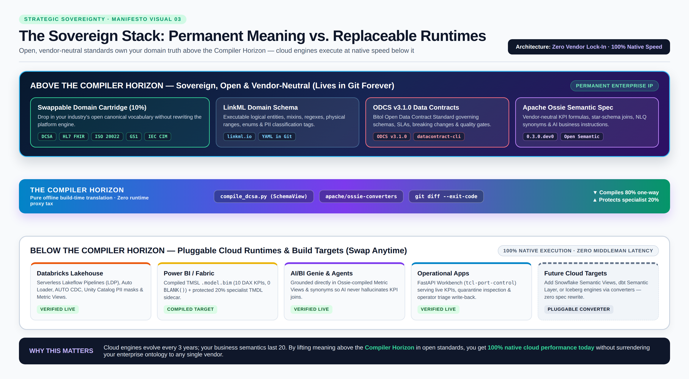
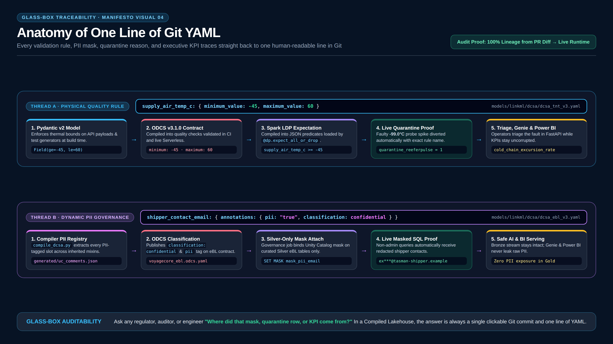

# The Compiled Lakehouse

> **Write meaning once. Compile the entire Lakehouse through a closed-loop Semantic Spine.**
>
> *Open, vendor-neutral standards (**LinkML**, **ODCS v3.1.0**, **Apache Ossie**) own your permanent business meaning — while cloud engines (**Databricks**, **Power BI**, **Fabric**, **Snowflake**) become replaceable, full-speed build targets.*

> [!NOTE]
> **Reference Proof Context:** Every code path, compiled artifact, and live metric cited in this manifesto is verified in this repository's working reference implementation for **Tasman Container Line (TCL)** — a **100% fictional** regional ocean carrier using synthetic DCSA maritime datasets.

---

## Act I — The Hand-Wired Trap

Modern enterprise data platforms rarely fail because Spark is too slow or cloud storage is too expensive. They fail because **business meaning is hand-wired five separate times across disconnected tools**:

1. An architect writes a logical data model in a slide deck or wiki — stale within two weeks because nothing executes it.
2. Backend engineers hand-code regexes and range checks in Python/API validators.
3. Data engineers re-type those same rules (slightly differently) in Spark SQL quality checks.
4. Governance teams draft separate data contracts and manually configure PII masks after a security review.
5. BI engineers and AI builders each re-implement executive KPIs (`Schedule Reliability %`, `Cold-Chain Excursion Rate %`) in SQL, DAX, and prompt instructions — until Operations and Finance arrive at Monday morning's meeting with two conflicting numbers.

<p align="center">
  
</p>

*(High-resolution interactive source: [`infographics/compiled_handwired_vs_compiled.html`](infographics/compiled_handwired_vs_compiled.html))*

Software engineering solved this exact class of problem fifty years ago: **stop hand-assembling downstream targets.** Write high-level intent once, run a deterministic compiler, and let CI reject any target artifact that drifts from source.

---

## Act II — Enter The Compiled Lakehouse

**The Compiled Lakehouse** applies compiler discipline to the entire modern data stack:

- **Your Git YAML specs are the source code** — logical domain models (**LinkML**) and analytical metric blueprints (**Apache Ossie**).
- **Your cloud artifacts are build targets** — Pydantic v2 models, JSON Schema, **ODCS v3.1.0** data contracts, Spark Lakeflow expectations, Unity Catalog PII masks & comments, Unity Catalog Metric Views, and Power BI `.model.bim` files.
- **Zero drift is enforced by CI, not human vigilance** — GitHub Actions runs both compilers and executes `git diff --exit-code generated contracts`. Uncompiled edits or forgotten regenerations fail closed before merge.

---

## Act III — The Semantic Spine

At the center of a Compiled Lakehouse sits one continuous backbone: **The Semantic Spine**.

Rather than letting five overlapping tools argue over who owns schemas, quality rules, and metrics, **every tool owns strictly one vertebra** along the spine:

```text
1. LinkML (Logical Domain Model)
   ↓  compile_dcsa.py (SchemaView)
2. ODCS v3.1.0 (Operational Boundary Contracts)
   ↓  generated/ldp_expectations.json + uc_comments.json
3. Lakeflow Declarative Pipelines (Bronze → Silver + Quarantine + AUTO CDC → Gold)
   ↓  gold_port_call_performance + gold_container_journey_reefer
4. Apache Ossie 0.3.0.dev0 (Vendor-Neutral Semantic Layer)
   ↓  apache/ossie-converters (Databricks + Microsoft)
5. Governed Consumption (UC Metric Views · AI/BI Genie · Power BI · FastAPI App)
```

---

## Act IV — Closed-Loop Physics: Compile Down, Verify Up

A one-way compiler eliminates **build-time drift** — but production data still breaks in the wild (malformed terminal container IDs like `BAD-CONT-99`, faulty `-99.0°C` reefer temperature probes, out-of-order ERP CDC events).

That is why the Semantic Spine is **closed-loop**:

- **Compile Down (Intent → Runtime):** Domain rules, regex patterns, physical ranges, PII tags, and KPI formulas compile downward deterministically from Git into every runtime surface.
- **Verify Up (Runtime → Governance):** Live Serverless **`datacontract-cli` (`spark_ibis`)** executes **420 / 420** compiled ODCS checks directly against Unity Catalog Delta tables and persists every audit result into `governance_dcsa.contract_test_results`. Poison-pill records divert into explicit `silver_dcsa.quarantine_*` tables with exact violated rule names, and controllers write triage resolutions back to Delta via the `tcl-port-control` FastAPI Workbench.

<p align="center">
  
</p>

*(Interactive source: [`infographics/compiled_semantic_spine_loop.html`](infographics/compiled_semantic_spine_loop.html))*

### Interactive Repository-Backed Architecture View

<p align="center">
  
</p>

- **Interactive Archify HTML:** Open [`docs/diagrams/tcl-semantic-spine-loop.html`](diagrams/tcl-semantic-spine-loop.html) locally to inspect clickable source line links across `models/`, `src/tcl_compiler/`, `contracts/`, `src/pipelines/`, `semantic/`, and `src/jobs/`.

---

## Act V — Sovereign Meaning, Replaceable Runtimes (and the 80/20 Covenant)

Cloud compute and BI vendors evolve every three years; your enterprise domain definitions and KPI formulas last twenty. **The Compiled Lakehouse** separates the two cleanly across a **Compiler Horizon**:

<p align="center">
  
</p>

*(Interactive source: [`infographics/compiled_sovereign_stack.html`](infographics/compiled_sovereign_stack.html))*

1. **Above the Compiler Horizon (Permanent Enterprise IP):** Open, vendor-neutral standards (**DCSA/FHIR/ISO 20022/GS1** + **LinkML** + **ODCS v3.1.0** + **Apache Ossie**) live cleanly in Git. No proprietary binary formats, no platform lock-in.
2. **At the Compiler Horizon (Zero Runtime Tax):** Both `compile_dcsa.py` and `apache/ossie-converters` run **purely offline at build time**. Neither LinkML nor Apache Ossie ever sits in your query hot path — eliminating proxy latency and extra SaaS bills.
3. **Below the Compiler Horizon (100% Native Speed + 80/20 Realism):** Databricks executes native Serverless Lakeflow Pipelines and Unity Catalog Metric Views (`MEASURE(...)`); Power BI executes native compiled DAX inside `.model.bim`. And following Martin Fowler's **80/20 Model-Driven Engineering** covenant, the compiler automates the boring 80% one-way while leaving the **specialist 20%** (`semantic/powerbi_overrides/dax_specialist_measures.tmdl`, custom PII masking UDFs, operator triage UX) cleanly protected outside codegen.

---

## Act VI — Glass-Box Traceability: Anatomy of One Line of Git YAML

When an auditor, regulator, or skeptical VP asks *"Where did that PII mask, quarantine alert, or KPI number actually come from?"*, a hand-wired platform responds with a three-day Slack archaeology dig.

In **The Compiled Lakehouse**, every single production behavior traces in a straight line back to **one line of human-readable Git YAML**:

<p align="center">
  
</p>

*(Interactive source: [`infographics/compiled_glass_box_traceability.html`](infographics/compiled_glass_box_traceability.html))*

- **Thread A (`supply_air_temp_c: { minimum_value: -45, maximum_value: 60 }`):** Compiles simultaneously into Pydantic (`Field(ge=-45, le=60)`), ODCS v3.1.0 numeric quality checks, and Spark LDP `@dp.expect_all_or_drop` — catching a faulty `-99.0°C` reefer probe in `quarantine_reeferpulse_iot_telemetry` before it can corrupt `cold_chain_excursion_rate_pct` in Genie or Power BI.
- **Thread B (`shipper_contact_email: { annotations: { pii: "true", classification: confidential } }`):** Propagates automatically into `generated/uc_comments.json`, the eBL ODCS contract, and Silver-only dynamic data masking (`mask_pii_email`), returning `ex***@tasman-shipper.example` to non-privileged queries while preserving untouched raw payloads in Bronze.

---

## Act VII — Working Proof & Swappable Industry Cartridges

Everything in this manifesto is **not slides — it is running, tested code** verified end-to-end on Databricks Free Edition:

- **5-Task Serverless Orchestrator:** `5/5` tasks `TERMINATED / SUCCESS`.
- **Live Native ODCS Verification (`spark_ibis`):** `420 / 420` checks passing across 5 contracts (`0` failures).
- **Quarantine, `AUTO CDC` & Silver PII Masking:** `2 + 1` poison pills isolated; SCD1 (`14`) and SCD2 (`31`) reconciled from out-of-order CDC; live email redaction verified.
- **Dual-Compiled Semantic Layer:** `10` governed KPIs compiled cleanly to both Unity Catalog Metric Views (`MEASURE(...)`) and Power BI `.model.bim` (`0` `BLANK()` fallbacks), powering both live **AI/BI Genie** and the **`tcl-port-control`** FastAPI Workbench.

### Swap 10% YAML, Keep 90% of the Lakehouse

Because the Semantic Spine is metadata-driven, **DCSA maritime shipping is simply the first Domain Cartridge**. Swap only `models/linkml/` and `semantic/ossie/`, and the exact same Compiled Lakehouse compiles for:

| Industry Cartridge | Open Standard | Domain Entities (`models/linkml/`) | Compiled KPIs (`semantic/ossie/`) |
| :--- | :--- | :--- | :--- |
| **Maritime Shipping** *(included)* | **DCSA** | `EquipmentEvent`, `ReeferTelemetryReading`, `TransportDocument`, `PortCallTimestamp` | `schedule_reliability_pct`, `cold_chain_excursion_rate_pct`, `avg_dwell_hours` |
| **Healthcare** | **HL7 FHIR** | `Patient`, `Encounter`, `Observation`, `MedicationRequest` | `bed_turnaround_mins`, `icu_vital_excursion_rate_pct`, `sepsis_bundle_sla_pct` |
| **Banking &amp; Payments** | **ISO 20022** | `PaymentInstruction`, `SettlementEvent`, `AccountParty` | `stp_settlement_rate_pct`, `high_value_latency_sec`, `sanctions_quarantine_count` |
| **Cold-Chain Retail** | **GS1 / EPCIS 2.0** | `EPCISEvent`, `ChillerReading`, `LotRecallDocument` | `on_shelf_availability_pct`, `chiller_excursion_rate_pct`, `recall_trace_mins` |
| **Energy &amp; Grid** | **IEC CIM** | `SubstationEvent`, `SmartMeterReading`, `OutageTicket` | `saidi_outage_mins`, `voltage_excursion_rate_pct`, `peak_load_factor_pct` |

---

### Continue Exploring
- **Inputs &amp; Outputs Deep-Dive + 5-Step Industry Fork Guide:** [`docs/CONCEPTS_AND_INDUSTRY_PORTABILITY.md`](CONCEPTS_AND_INDUSTRY_PORTABILITY.md)
- **Full Technical Architecture:** [`docs/ARCHITECTURE.md`](ARCHITECTURE.md)
- **Build Locally (2 min) or on Databricks Free Edition (10 min):** [`docs/DEPLOYMENT_GUIDE.md`](DEPLOYMENT_GUIDE.md)
